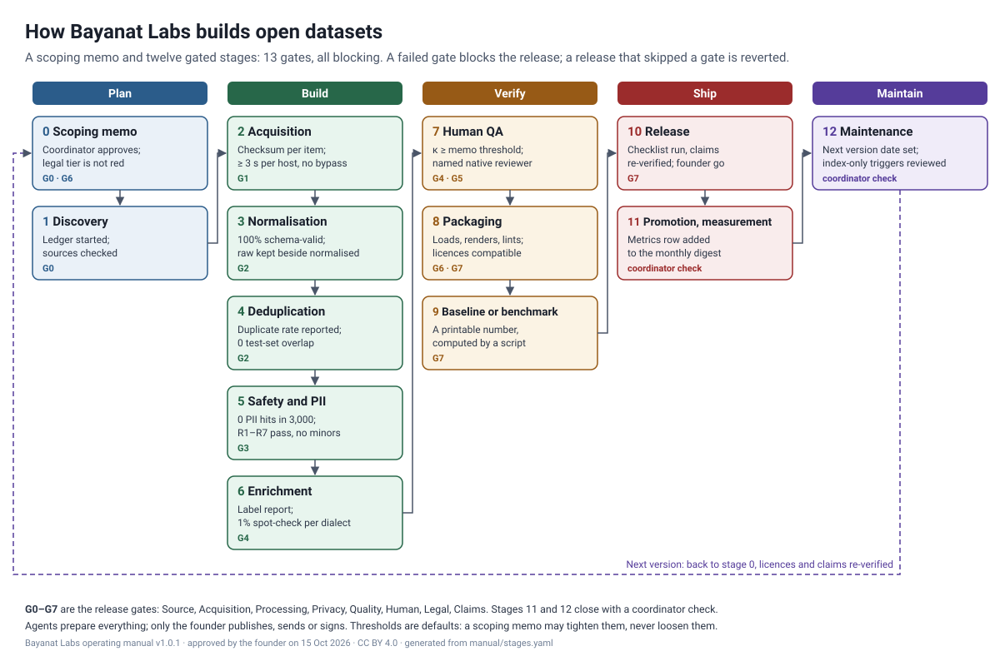

<div dir="rtl" lang="ar">

# كيف تبني بيانات لابز مجموعات البيانات المفتوحة

الإصدار 1.0.1 · 15 أكتوبر 2026 · اعتمده المؤسس في 15 أكتوبر 2026 · النص بترخيص CC BY 4.0، والمخططات والبرامج النصية بترخيص Apache-2.0 · صيغة نسب المصنف: «Operating manual by Bayanat Labs» (دليل التشغيل من بيانات لابز) · توثيق، وليس استشارة قانونية · للتواصل: hello@bayanatlabs.com

هذه هي النسخة العربية من دليل تشغيل برنامج البيانات المفتوحة لدى بيانات لابز (Bayanat Labs)، والنسخة الإنجليزية هي `manual/PUBLIC.md`. وعند أي اختلاف بين النسختين تسري النسخة الإنجليزية والملف `manual/stages.yaml`. وتبقى أسماء الملفات والحقول ومعرّفات الفحوص والتعابير البرمجية بالحروف اللاتينية كما هي، لأن الأدوات تقرؤها.

## 1. ما هذا الدليل

تمر كل مجموعة بيانات مفتوحة تصدرها بيانات لابز بخط الإنتاج نفسه: مذكرة تحديد النطاق في المرحلة 0، ثم اثنتا عشرة مرحلة أخرى، تُختم كل منها ببوابة. فالمجموع 13 بوابة، وكلها مانعة: إذا فشلت بوابة توقّف الإصدار، وأي إصدار تخطى بوابةً يُسحب.

الدليل هو العملية: ما الذي يحدث، وبأي ترتيب، وكيف تُفحص كل خطوة. أما ما يجوز إصداره، وبأي ترخيص، فتحدده سياسة برنامج البيانات المفتوحة لدى بيانات لابز (المجلد `policy/` في هذا المستودع: مستويات النشر ومصفوفة التراخيص ومعايير الاختيار). ويجوز لمذكرة تحديد النطاق تشديد أي عتبة في هذا الدليل؛ أما تخفيفها فيحتاج إلى موافقة مكتوبة من المؤسس.

**المواقف القانونية.** كل مرحلة أو بوابة أو قاعدة توقف تحتاج إلى موقف قانوني تستشهد بالقرار المسجَّل الذي تستند إليه، بمعرّف ذلك القرار. ولا تنتظر أي مرحلة اعتمادًا قانونيًا منفصلًا.

**مصدر واحد للحقيقة.** لا يوجد جدول المراحل إلا في `manual/stages.yaml`. والجداول في القسم 3 من هذا الدليل وفي جدول المقابلة بين البوابات مولَّدة منه. وتثبّت أداة الفحص `bl-gates` في قالب مجموعات البيانات لدى بيانات لابز الملفَ `stages.yaml` برقم إصداره، وتسجل كل بطاقة مجموعة بيانات `manual_version` في قسم الإنشاء.

| الملف | ما يحتويه |
|---|---|
| `manual/PUBLIC.md`، `manual/PUBLIC.ar.md` | هذا الدليل بالإنجليزية والعربية؛ وأقسام المراحل فيه مولَّدة من `manual/stages.yaml` |
| `manual/stages.yaml` و`manual/schemas/stages.schema.json` | المراحل الثلاث عشرة: الإجراءات، والأدوات، والمدخلات، والمخرجات، وفحوص البوابات، والعتبات، والمسؤول، وشروط التوقف، والمقابلة مع G0-G7 |
| `manual/gate-crosswalk.md` | المراحل مقابل بوابات الإصدار G0-G7، والخيارات التي اعتمدها الدليل حيث اختلفت مصادره |
| `manual/SCOPING_MEMO.md`، `manual/scoping_memo.schema.json`، `manual/schemas/scoping_memo_record.schema.json` | قالب المرحلة 0؛ وكتلة درجات التقييم بصيغة `bl-score`؛ وسجل المذكرة الذي تقرؤه البوابات اللاحقة |
| `manual/dod.yaml` | تعريف الإنجاز ذو البنود الاثني عشر، الذي تقرؤه `bl-gates --dod` |
| `manual/etiquette.md`، `manual/stop_rules.md` | آداب الزحف وقواعد التوقف |
| `manual/tooling.lock.yaml` | الأدوات والنماذج المثبّتة مع تراخيصها المتحقق منها |
| `manual/budget.py` | مقدّر الميزانية |
| `coordinator/` | إجراء السجلات، وقائمة فحص حزمة الإطلاق، ومخطط صف ملخص المقاييس، وتقويم الصيانة |
| `scripts/validate_stages.py` | يتحقق من `stages.yaml` و`dod.yaml`، ويقيّم كل بوابة على مواد فعلية |

**الأسماء المستخدمة هنا.**

| الاسم | معناه |
|---|---|
| `bl-score` | أداة سطر الأوامر التي تطبّق معايير الاختيار في السياسة على مذكرة تحديد النطاق (`tools/bl-score`) |
| `bl-gates`، `bl-card-lint`، `bl-manifest`، `bl-card-render` | أدوات الإصدار المرافقة لقالب مجموعات البيانات لدى بيانات لابز (`Bayanat-Labs/dataset-template`) |
| `arabic-normalize` | أداة بيانات لابز لتطبيع النص العربي (سياسات Bayanat-Norm) |
| حزمة التعرف العربية | حزمة بيانات لابز العربية للتعرف على البيانات الشخصية في Presidio |
| الخادم داخل المملكة | خادم الزحف لدى بيانات لابز داخل المملكة، ويُستخدم للمواقع التي تحجب الطلبات الواردة من الخارج |
| معرّف القرار | المعرّف (`decision_id`) لقرار قانوني مسجَّل؛ وهو الصيغة الوحيدة التي يُستشهد بها لأي موقف قانوني |
| الإجراءات المقصورة على المؤسس | الحسابات، والاعتماد القانوني، والاتفاقيات، والمدفوعات، والتواصل الخارجي، والنشر، والبنية التحتية، والحوادث القانونية، والتغييرات التي تحذف بيانات، واعتماد الادعاءات. ولا يتخذها الوكلاء أبدًا |
| G0-G7 | بوابات الإصدار الثماني: المصدر، والجلب، والمعالجة، والخصوصية، والجودة، والمراجعة البشرية، والقانون، والادعاءات |
| المستوى 1 / 2 / 3 | محتوى مفتوح / بيانات وصفية ووسومنا فقط / محتوى مرخّص من شريك (`policy/tiers.yaml`) |

**المصادر.** تعكس المراحل والعتبات الممارسة لدى بيانات لابز والأعمال المنشورة المذكورة حيث تُستخدم. وحيث يهم رقم ما، يذكره هذا الدليل كاملًا.

## 2. خط الإنتاج في لمحة



| المرحلة | الاسم | البوابة (شرط الاجتياز) | المسؤول | الاعتماد | بوابات G |
|---|---|---|---|---|---|
| 0 | مذكرة تحديد النطاق | يعتمد المنسّق المذكرة ويحدّد التصنيف القانوني، على ألا يكون أحمر؛ ويوجد الملف `job.json` والإجراءات الخارجية فيه معطّلة. | المنسّق | المنسّق | G0 المصدر، G6 القانون |
| 1 | الاستكشاف | بدأ سجل المنشأ؛ وفُحص ترخيص كل عنصر وشروطه؛ وخُزّنت إعدادات الاشتراك في التدريب عمودًا للتصفية؛ وفُحصت الحسابات التي ترفع محتوى بترخيص المشاع الإبداعي بحثًا عن غسل التراخيص؛ ولكل مصدر أساس مسجَّل في شروط الاستخدام (`tos_basis`). | الوكيل | وكيل مجموعة البيانات | G0 المصدر |
| 2 | الجلب | اكتمل المخزن الخام مع مجموع اختباري ووقت جلب لكل عنصر؛ واتُّبعت آداب الزحف؛ وسُجّل كل رفض للوصول ولم يُتجاوز قط؛ ولكل عنصر من المستوى 2 أساس الجمع المسمّى في المذكرة. | الوكيل | وكيل مجموعة البيانات، المنسّق | G1 الجلب |
| 3 | التطبيع | ينجح التحقق من المخطط على 100% من السجلات؛ وتُسجَّل نسخة التطبيع؛ وتبقى الحقول الخام والمطبَّعة جنبًا إلى جنب؛ وتأتي نصوص الكلام المفرّغة من تسميات توضيحية يدوية أو من اتفاق نظامين للتعرف الآلي على الكلام (CER لا يتجاوز 15%)، ولا تأتي أبدًا من التسميات التوضيحية التلقائية. | الوكيل | وكيل مجموعة البيانات | G2 المعالجة |
| 4 | إزالة التكرار | يُبلَّغ عن معدل التكرار وإحصاءات تحديد اللغة، وتقع ضمن النطاقات المحددة في المذكرة؛ ولا تداخل إطلاقًا بين أي مجموعة اختبار لمعيار مرجعي وأي إصدار تدريبي. | الوكيل | وكيل مجموعة البيانات | G2 المعالجة |
| 5 | السلامة والبيانات الشخصية | صفر نتائج للبيانات الشخصية في تدقيق طبقي على 3,000 سجل (ويُبلَّغ أيضًا عن معدل متبقٍّ أقل من 0.1% في أول 1,000 سجل)؛ ونجاح اختبارات R1-R7؛ ولا وسوم لفئات حساسة؛ وطمس الوجوه ولوحات المركبات؛ ولا قاصرين؛ واجتياز التدقيق قبل أي رفع إلى خارج السعودية والإمارات. | الوكيل | وكيل مجموعة البيانات، المنسّق | G3 الخصوصية |
| 6 | الإثراء | يوجد تقرير توزيع الوسوم؛ وأُنجز فحص عيّني يدوي لا يقل عن 1% لكل لهجة على أيدي متحدثي تلك اللهجة؛ ولكل وسم الحقل `annotation_origin`. | الوكيل | وكيل مجموعة البيانات، مراجع من أهل اللغة | G4 الجودة |
| 7 | المراجعة البشرية للجودة | يبلغ الاتفاق عتبة المذكرة (الحد الأدنى لمعامل كابا 0.6، و0.7 لمجموعات التقييم)؛ وتستوفي أحجام العيّنات الحدود الدنيا في عتبات المرحلة 7؛ ويوقّع مراجع مسمّى من أهل اللغة؛ ويُدرج تقرير ضبط الجودة في البطاقة. | الوكيل | مراجع من أهل اللغة، المنسّق | G4 الجودة، G5 المراجعة البشرية |
| 8 | التحزيم | يعمل عارض البيانات؛ وتعمل `datasets.load_dataset` في بيئة نظيفة؛ ويجتاز مدقق البطاقة؛ وفُحص توافق التراخيص ونُقلت التزاماتها؛ وكل عنصر يحتاج إلى قرار قانوني مسجَّل يستشهد به؛ والملفات المطلوبة موجودة. | الوكيل | وكيل مجموعة البيانات، المنسّق | G6 القانون، G7 الادعاءات |
| 9 | خط الأساس أو المعيار المرجعي | يوجد رقم يحسبه برنامج نصي ويستطيع الصحفي نشره، مع رسمه البياني والبرنامج الذي يرسمه. | الوكيل | وكيل مجموعة البيانات | G7 الادعاءات |
| 10 | الإصدار | يشغّل المنسّق قائمة فحص حزمة الإطلاق؛ ويُعاد التحقق من الادعاءات يوم الإصدار (G7)؛ وتُسجَّل موافقة المؤسس. | المنسّق | المنسّق، المؤسس | G7 الادعاءات |
| 11 | الترويج والقياس | يُضاف صف مقاييس للإصدار إلى الملخص، ويتوافق مع `coordinator/metrics_digest_row.schema.json`. | المنسّق | المنسّق | فحص المنسّق |
| 12 | الصيانة | حُدّد موعد النسخة التالية في `job.json` وفي تقويم الإصدارات؛ وروجعت محفزات الاقتصار على الفهرسة IO-1 إلى IO-5 في السياسة لهذه النسخة. | المنسّق | المنسّق، المؤسس | فحص المنسّق |

**الأدوار.**

| الدور | يعتمد | لا يفعل أبدًا |
|---|---|---|
| وكيل مجموعة البيانات | بوابات المراحل 1-9 لإصداره، مع مسارات الأدلة | أي إجراء خارجي: الحسابات، وتسجيل الدخول، وقبول الشروط، والمدفوعات، والرسائل، والنشر |
| المنسّق | اعتماد المرحلة 0، وقائمة فحص المرحلة 10، والمرحلتين 11 و12؛ ويدير السجلات والتقويم وحزم الإطلاق والمقاييس | اعتماد عمل وكيله دون ملفات الأدلة |
| مراجع من أهل اللغة | اعتماد المرحلة 7؛ ويفحص متحدثو كل لهجة وسوم لهجتهم | اعتماد وسوم لأن نموذجًا شرحها بطريقة مقنعة |
| المؤسس | موافقة المرحلة 10، واعتماد صيغ التفضيل، وكل إجراء خارجي | — |

يُفصل بين العاملين والمقيّمين: وكيل يجلب، وآخر يحوّل، وثالث يقيّم.

**كيف تُفحص البوابة.** كل بوابة قائمة من الفحوص القابلة للتنفيذ آليًا على ملفات في أربعة جذور: مجلد المهمة، ومستودع مجموعة البيانات في Hugging Face، ومستودع البناء في GitHub، ومساحة عمل المنسّق. وللفحوص ستة أنواع: ملف موجود؛ وملف غير موجود (مثل: لا ملفات بيانات في مستودع GitHub)؛ وملف يتوافق مع مخطط JSON Schema؛ ومقياس في تقرير JSON أو YAML يبلغ عتبة (قيمة ثابتة، أو قيمة من المذكرة، أو حقلًا آخر)؛ واعتماد موقَّع باسم صاحبه مع تاريخ وحكم؛ وصف موجود في سجل، مع حقول مطلوبة مملوءة عند الحاجة. وهناك جذر خامس هو `legal_record`، وهو السجل القانوني للمؤسسة (يُضبط مساره في الإعدادات): جدول القرارات المسجَّلة الذي تقرؤه الفحوص القانونية بمعرّف القرار. ولا يكون الفحص منطبقًا أو غير منطبق إلا بشرط على سجل المذكرة؛ فإذا خلا السجل من الحقل عُدّ الفحص خطأً، ولا يُعدّ غير منطبق أبدًا. ولكل تقرير يقرؤه فحص مخطط JSON Schema في `manual/schemas/reports/` مولَّد من الفحوص. ولا يدخل الحكم البشري إلا عبر الاعتمادات الموقَّعة بأسماء أصحابها. ويشغّل الأمر `scripts/validate_stages.py --evaluate` كل الفحوص ويكتب تقريرًا؛ أما أداة `bl-gates` في قالب مجموعات البيانات فهي أداة الفحص المعتمدة في الإنتاج، وتكتب `qa/reports/gates.json`.

<div dir="ltr">

```bash
python scripts/validate_stages.py manual/stages.yaml --dod manual/dod.yaml --tooling manual/tooling.lock.yaml   # validate the manual
python scripts/validate_stages.py manual/stages.yaml --evaluate --stages 0-8 \
    --job <job dir> --hf <hf checkout> --gh <builder checkout> --programme <coordinator dir>
python scripts/validate_stages.py manual/stages.yaml --dod manual/dod.yaml --evaluate --phase rc --job ...
```

</div>

## 3. المراحل الثلاث عشرة

هذا القسم مولَّد من `manual/stages.yaml` ومن النصوص العربية في `manual/i18n/stages.ar.yaml`. والمسارات نسبية إلى جذورها: `job` مجلد المهمة، و`hf_repo` مستودع مجموعة البيانات في Hugging Face، و`gh_repo` مستودع البناء في GitHub، و`programme` مساحة عمل المنسّق، و`legal_record` السجل القانوني للمؤسسة (يُضبط مساره في الإعدادات). وتأتي قيم `memo:` من سجل مذكرة تحديد النطاق المعتمدة (`scoping_memo.yaml`). والتعابير في جداول الفحوص برمجية، فتبقى بالإنجليزية.

### المرحلة 0: مذكرة تحديد النطاق

**الغرض.** تقرير ما إذا كان الإصدار يستحق البناء ويمكن بناؤه قانونيًا، في صفحة واحدة مع جداول، قبل جلب أي شيء.

**المسؤول:** المنسّق · **الاعتماد:** المنسّق · **بوابات G:** G0 المصدر، G6 القانون · **مانعة:** نعم

**ما يفعله الوكيل**

- املأ `manual/SCOPING_MEMO.md` وسجلّها `scoping_memo.yaml`: معرّف المرشح، والادعاء المراد، والإصدارات القائمة المنافسة وأحجامها مع روابطها، والمصادر مع تراخيصها وشروطها، ومستوى الإصدار، وخطة الترخيص لكل إعداد، وأساس الجمع للمستوى 2، والأولوية، والصلة بالمنتج، والمخاطر، وعيّنة ضبط الجودة وعتبة الاتفاق، والميزانية، والمسؤول، والتواريخ، وشروط التوقف.
- اكتب كتلة التقييم `scoping_memo.score.yaml` بالصيغة الدقيقة لأداة `bl-score` (خمس درجات من 1 إلى 5، والتصنيف القانوني، والجهد، وتبرير من سطر واحد لكل درجة)، وشغّل نسخة `bl-score` المثبّتة (`manual/bl-score.pin.json`: مثبّتة ببصمة ملفاتها لا برقم إصدارها)، واحفظ مخرجاتها بصيغة JSON في `scoping_memo.score.json`، وسجّل بصمة شجرة ملفات أداة التقييم في الحقل `score_tool_sha256`. والتصنيف القانوني الأحمر، أو درجة نظافة قانونية تساوي 1، ينهي المهمة؛ والدرجة 2 أو 3 تحصر الإصدار في المستوى 2.
- سجّل لكل مصدر مسار ترخيصه (`licence_route`، وهو معرّف ترخيص المدخلات في `policy/licence-matrix.yaml`) ومستوى النشر الذي يبلغه محتواه (`release_tier`)، ولا تستند إلى أي موقف قانوني إلا بمعرّف القرار المسجَّل الذي يقوم عليه (`decision_ref`). ولا يُقبل نص حر في هذا الحقل.
- أعد في يوم كتابة المذكرة نفسه التحقق من الإصدار القائم الذي يُقارَن به الادعاء ومن ترخيص كل مصدر.
- اكتب `job.json` (المخطط: `manual/schemas/reports/job.schema.json`) واجعل `external_actions_authorized` بالقيمة `false`.

**الأدوات** (مفاتيح في `manual/tooling.lock.yaml`؛ والبادئة `bayanatlabs:` تعني أدوات بيانات لابز الخاصة): `bayanatlabs:bl-score`

**المدخلات:** بند المرشَّح لتحديد النطاق؛ ترخيص كل مصدر وشروطه؛ السجل القانوني للمؤسسة (يُضبط مساره في الإعدادات): القرارات المسجَّلة بمعرّفاتها (`decision_id`)، وهي المصدر الوحيد الذي يُستشهد به لأي موقف قانوني؛ سياسة برنامج البيانات المفتوحة: معايير التقييم، ومستويات النشر، ومصفوفة التراخيص (المجلد `policy/` في `Bayanat-Labs/open-policies`)؛ `manual/bl-score.pin.json` (بصمة شجرة ملفات `bl-score`)؛ تقدير الميزانية من `manual/budget.py`

**المخرجات:** `job:scoping_memo.md`؛ `job:scoping_memo.yaml`؛ `job:scoping_memo.score.yaml`؛ `job:scoping_memo.score.json`؛ `job:job.json`

**البوابة.** يعتمد المنسّق المذكرة ويحدّد التصنيف القانوني، على ألا يكون أحمر؛ ويوجد الملف `job.json` والإجراءات الخارجية فيه معطّلة.

| الفحص | التعبير القابل للفحص آليًا |
|---|---|
| `S0.memo` | `exists(job:scoping_memo.md, job:scoping_memo.yaml, job:scoping_memo.score.yaml, job:scoping_memo.score.json)` |
| `S0.memo_schema` | `valid(job:scoping_memo.yaml, manual/schemas/scoping_memo_record.schema.json)` |
| `S0.score_schema` | `valid(job:scoping_memo.score.yaml, manual/scoping_memo.schema.json)` |
| `S0.legal_tier` | `job:scoping_memo.score.yaml:legal_tier in ["green", "yellow"]` |
| `S0.rubric_scored` | `job:scoping_memo.score.json:legal_verdict in ["tier1_eligible", "tier2_only"]` |
| `S0.score_tool_pinned` | `job:scoping_memo.yaml:score_tool_sha256 in ["daf73c4e0139cb2d7e489dce2db293e5ea50880df1ceb2effc9e794161da27bc"]` |
| `S0.same_candidate` | `job:scoping_memo.score.json:candidate_id == memo:candidate_id` |
| `S0.coordinator_approval` | `signoff(job:scoping_memo.yaml:decision.coordinator, role=coordinator, verdict=approve)` |
| `S0.legal_tier_assigned` | `job:scoping_memo.yaml:decision.legal_tier_assigned is_true` |
| `S0.job_spec` | `valid(job:job.json, manual/schemas/reports/job.schema.json)` |
| `S0.no_external_actions` | `job:job.json:external_actions_authorized is_false` |

| العتبة | القيمة الافتراضية (يجوز للمذكرة تشديدها لا تخفيفها) | مصدرها |
|---|---|---|
| `T0.legal` التصنيف القانوني الذي يسمح بالمتابعة | أخضر أو أصفر؛ والأحمر لا يُبنى | البوابة القانونية في `policy/rubric.yaml` |
| `T0.tighten_only` تعديلات المذكرة على العتبات | التشديد فقط؛ والتخفيف يحتاج إلى موافقة مكتوبة من المؤسس | الممارسة لدى بيانات لابز |

**شروط التوقف**

- التصنيف القانوني أحمر، أو حكم `bl-score` القانوني (`legal_verdict`) هو `excluded`: أسقط المرشح، وسجّل السبب، وانتقل إلى مصدر بديل اجتاز البوابة بصورة مستقلة.
- لم تُقرأ شروط أحد المصادر بعد: اقرأها واحفظها قبل اعتماد المذكرة.
- الادعاء يحتاج إلى صيغة «الأول» أو «الوحيد» ولا يوجد بحث محفوظ يدعمه: اكتب «لا ادعاء مقارنًا» حتى يُنجز البحث.
- رفض المنسّق المذكرة أو طلب مراجعتها: لا يُجلب أي محتوى.

### المرحلة 1: الاستكشاف

**الغرض.** حصر كل عنصر مرشح وتسجيل إشارات الحقوق الخاصة به قبل جلب أي محتوى.

**المسؤول:** الوكيل · **الاعتماد:** وكيل مجموعة البيانات · **بوابات G:** G0 المصدر · **مانعة:** نعم

**ما يفعله الوكيل**

- احصر ملفات التفريغ الكاملة (dumps) وواجهات البرمجة وخرائط المواقع وخلاصات RSS وقوائم الرفع في القنوات.
- سجّل لكل عنصر: ملف robots.txt (مع بصمته)، وTDMRep، وContent-Signal، وفي منصات الفيديو حالة الترخيص وأي إعداد للاشتراك في التدريب تتيحه المنصة.
- ابدأ الملف `sources.jsonl` (صف لكل مصدر) وسجل المنشأ لكل عنصر.
- افحص ترخيص كل عنصر وشروطه الخاصة. وتعامل مع أي حجب لزواحف GPTBot أو CCBot أو Google-Extended على أنه تعبير عن نية صاحب الموقع: هذه المواقع للمعرّفات فقط.
- خزّن إعداد المنصة للاشتراك في التدريب عمودًا للتصفية. فهو معطّل افتراضيًا، فلا يُعامل أبدًا على أنه انسحاب.
- افحص الحسابات التي ترفع محتوى بترخيص المشاع الإبداعي بحثًا عن غسل التراخيص: مراجعة منشأ المحتوى لكل حساب، ومطابقة البصمات مع مواد أصحاب الحقوق المعروفين، واستبعاد الحسابات التي تعيد نشر مواد مختلطة التراخيص.
- العناصر ذات الترخيص القياسي تُنشر في المستوى 2 (البيانات الوصفية من الواجهة البرمجية والمعرّفات). ولا تُستخدم التسميات التوضيحية التلقائية نصوصًا مفرّغة أبدًا.
- اختبر من 10 إلى 100 سجل ممثِّل، أو أصغر ملف مسموح به، قبل أي تشغيل واسع.

**الأدوات** (مفاتيح في `manual/tooling.lock.yaml`؛ والبادئة `bayanatlabs:` تعني أدوات بيانات لابز الخاصة): `bayanatlabs:discover`

**المدخلات:** `job:scoping_memo.yaml`؛ `job:job.json`؛ `legal_record:.`

**المخرجات:** `job:sources.jsonl`؛ `job:PROVENANCE.parquet or PROVENANCE.jsonl (under 100k rows)`؛ `job:qa/reports/discovery.json`

**البوابة.** بدأ سجل المنشأ؛ وفُحص ترخيص كل عنصر وشروطه؛ وخُزّنت إعدادات الاشتراك في التدريب عمودًا للتصفية؛ وفُحصت الحسابات التي ترفع محتوى بترخيص المشاع الإبداعي بحثًا عن غسل التراخيص؛ ولكل مصدر أساس مسجَّل في شروط الاستخدام (`tos_basis`).

| الفحص | التعبير القابل للفحص آليًا |
|---|---|
| `S1.sources` | `exists(job:sources.jsonl)` |
| `S1.sources_schema` | `valid(job:sources.jsonl, templates/provenance_ledger_schema.json#/$defs/source_record)` |
| `S1.ledger_started` | `exists_any(job:PROVENANCE.parquet, job:PROVENANCE.jsonl)` |
| `S1.report` | `exists(job:qa/reports/discovery.json)` |
| `S1.red_excluded` | `job:qa/reports/discovery.json:red_items_included == 0` |
| `S1.tos_basis` | `job:qa/reports/discovery.json:sources_without_tos_basis == 0` |
| `S1.terms_read` | `job:qa/reports/discovery.json:sources_terms_not_reviewed == 0` |
| `S1.rights_signals` | `[if memo:third_party_sources is_true] job:qa/reports/discovery.json:items_missing_rights_signals == 0` |
| `S1.trainability_column` | `[if memo:uses_video_host is_true] job:qa/reports/discovery.json:video_host.trainability_stored_as_filter_column is_true` |
| `S1.laundering_screen` | `[if memo:uses_video_host is_true] job:qa/reports/discovery.json:video_host.cc_uploaders_unscreened == 0` |
| `S1.no_auto_captions` | `[if memo:uses_video_host is_true] job:qa/reports/discovery.json:video_host.auto_captions_used == 0` |
| `S1.probe` | `[if memo:third_party_sources is_true] job:qa/reports/discovery.json:probe_records >= 10` |

| العتبة | القيمة الافتراضية (يجوز للمذكرة تشديدها لا تخفيفها) | مصدرها |
|---|---|---|
| `T1.probe` الاختبار قبل التشغيل الواسع | من 10 إلى 100 سجل، أو أصغر ملف مسموح به | الممارسة لدى بيانات لابز |
| `T1.cohorts` دفعات المصادر الجديدة المتوازية | 3 على الأكثر | الممارسة لدى بيانات لابز |
| `T1.red` العناصر ضمن النطاق التي لا يسمح ترخيصها أو شروطها بالإصدار | 0 | الممارسة لدى بيانات لابز |

**شروط التوقف**

- حجز ملف robots.txt أو TDMRep (`tdm-reservation: 1`) أو Content-Signal (`ai-train=no`) المحتوى: الموقع للمعرّفات فقط.
- شروط مصدر لم تُقرأ: اقرأها واحفظها قبل لمس المصدر.
- اشتباه في غسل التراخيص لدى حساب رافع: استبعد الحساب.
- ظهرت بيانات شخصية حقيقية لم تخطط لها المذكرة: توقف واسأل المنسّق.

### المرحلة 2: الجلب

**الغرض.** جلب ما تسمح به المذكرة فقط، بتهذيب وبطريقة قابلة للاستئناف، مع مجموع اختباري لكل كائن.

**المسؤول:** الوكيل · **الاعتماد:** وكيل مجموعة البيانات، المنسّق · **بوابات G:** G1 الجلب · **مانعة:** نعم

**ما يفعله الوكيل**

- اجلب باستخدام وكيل المستخدم `BayanatLabs-OpenData/1.0 (+https://bayanatlabs.com/open; hello@bayanatlabs.com)`، ولا تنتحل أبدًا وكيل مستخدم لمتصفح.
- طلب واحد على الأكثر كل 3 ثوانٍ لكل مضيف (وطلب كل 5 ثوانٍ للبوابات الحكومية والمواقع الصغيرة والمضيفات التي تتباطأ)؛ واتصال واحد في الوقت نفسه لكل مضيف؛ واحترم قيمة Crawl-delay إن كانت أطول.
- تنزيلات قابلة للاستئناف؛ وبصمة SHA-256 لكل كائن؛ ووقت الجلب ورمز حالة HTTP لكل كائن؛ والمحتوى الخام في مخزن التجهيز المعنون بالمحتوى.
- لا تُجلب المواقع التي تحجب الطلبات الواردة من خارج المملكة إلا من خادم بيانات لابز داخل المملكة؛ ولا يُستخدم أبدًا خادم وسيط أو شبكة افتراضية خاصة أو موقع مرآة.
- فيديو المشاع الإبداعي، فقط حيث تضبط المذكرة الحقل `video_media_download` وينجح الفحص `S2.media_download_decision`: أداة yt-dlp مع الخيار `--download-archive`، وفترات انتظار وحدود للمعدل، وعنوان IP ثابت واحد لكل عامل؛ ولا تدوير للخوادم الوسيطة، ولا تجاوز لاختبارات CAPTCHA أو لجدار حماية تطبيقات الويب (WAF) أو لكشف البوتات، ولا ملفات تعريف ارتباط شخصية أبدًا؛ وتُسجَّل في المذكرة المخاطر المتبقية المتعلقة بشروط الخدمة.
- يغطي كلَّ عنصر من المستوى 2 أساسُ الجمع المسمّى في المذكرة (شريك أكاديمي يجمع بموجب المادة 3 أو 4 من توجيه السوق الرقمية الموحدة في الاتحاد الأوروبي، أو إذن مكتوب، أو قرار مسجَّل يسمح بذلك)؛ ويبقى الحجم محدودًا حتى يوجد هذا الأساس.
- المستوى 3: يكون إذن الشريك المكتوب محفوظًا قبل الجمع، ويُدرج مرجعه في الحقل `permission_doc_id` في كل صف (المستوى 3 في `policy/tiers.yaml`).

**الأدوات** (مفاتيح في `manual/tooling.lock.yaml`؛ والبادئة `bayanatlabs:` تعني أدوات بيانات لابز الخاصة): `bayanatlabs:fetch`، `yt-dlp`، `huggingface_hub`

**المدخلات:** `job:sources.jsonl`؛ `job:job.json`؛ `legal_record:.`

**المخرجات:** `job:intake/manifest.parquet`؛ `job:intake/objects/<sha256>`؛ `job:qa/reports/acquisition.json`

**البوابة.** اكتمل المخزن الخام مع مجموع اختباري ووقت جلب لكل عنصر؛ واتُّبعت آداب الزحف؛ وسُجّل كل رفض للوصول ولم يُتجاوز قط؛ ولكل عنصر من المستوى 2 أساس الجمع المسمّى في المذكرة.

| الفحص | التعبير القابل للفحص آليًا |
|---|---|
| `S2.manifest` | `exists(job:intake/manifest.parquet)` |
| `S2.report` | `exists(job:qa/reports/acquisition.json)` |
| `S2.checksums` | `job:qa/reports/acquisition.json:items_with_sha256 == items_total` |
| `S2.timestamps` | `job:qa/reports/acquisition.json:items_with_retrieved_at == items_total` |
| `S2.user_agent` | `[if memo:third_party_sources is_true] job:qa/reports/acquisition.json:user_agent == "BayanatLabs-OpenData/1.0 (+https://bayanatlabs.com/open; hello@bayanatlabs.com)"` |
| `S2.rate` | `[if memo:third_party_sources is_true] job:qa/reports/acquisition.json:min_seconds_between_requests_per_host >= 3` |
| `S2.rate_gov` | `[if memo:third_party_sources is_true] job:qa/reports/acquisition.json:min_seconds_between_requests_government_or_small_hosts >= 5` |
| `S2.pinned_upstream` | `[if memo:third_party_sources is_false] job:qa/reports/acquisition.json:upstream_commit not_null` |
| `S2.concurrency` | `job:qa/reports/acquisition.json:max_concurrency_per_host <= 1` |
| `S2.denials_not_bypassed` | `job:qa/reports/acquisition.json:access_denials_bypassed == 0` |
| `S2.no_rotation` | `job:qa/reports/acquisition.json:proxy_or_ip_rotation_used is_false` |
| `S2.tier2_basis` | `job:qa/reports/acquisition.json:tier2_items_without_collection_basis == 0` |
| `S2.media_download_decision` | `[if memo:video_media_download is_true] row(legal_record:., decision_id=memo:media_download_decision_ref, nonempty=answer+effective_date+source)` |

| العتبة | القيمة الافتراضية (يجوز للمذكرة تشديدها لا تخفيفها) | مصدرها |
|---|---|---|
| `T2.rate` الطلبات لكل مضيف | طلب واحد على الأكثر كل 3 ثوانٍ؛ وكل 5 ثوانٍ للمضيفات الحكومية والصغيرة والمتباطئة؛ واتصال واحد في الوقت نفسه | الممارسة لدى بيانات لابز (أبطأ من قيمة طلب واحد في الثانية التي دُرست أيضًا) |
| `T2.429` التعامل مع الرمز 429 | احترم Retry-After وتراجع تراجعًا أُسّيًّا؛ وبعد ثلاثة ردود 429 متتالية أوقف التعامل مع المضيف 24 ساعة؛ ولا تُعِد المحاولة من عنوان IP آخر أبدًا | الممارسة لدى بيانات لابز |
| `T2.denials` 401 أو 403 أو تسجيل الدخول أو CAPTCHA أو WAF | توقف وسجّل؛ وينتقل المصدر إلى الحالة `permission_required` | الممارسة لدى بيانات لابز |
| `T2.first_party` المحتوى الذي تملكه بيانات لابز | لا تكون فحوص آداب الزحف غير منطبقة إلا حين تكون المصادر كلها محتوى تملكه بيانات لابز (الحقل `third_party_sources` في المذكرة `false`)؛ ويُثبَّت بدلًا منها الإيداع البرمجي (commit) للمصدر | اعتمده المؤسس للإصدار 1.0 في 15 أكتوبر 2026 |

**شروط التوقف**

- الرمز HTTP 429: توقف عن الطلب من ذلك المضيف واحترم Retry-After؛ وبعد ثلاثة ردود 429 متتالية توقف 24 ساعة وسجّل ذلك.
- الرمز 401 أو 403، أو جدار تسجيل الدخول، أو اختبار CAPTCHA، أو تحدي WAF: توقف وسجّل الرفض؛ ولا تُعِد المحاولة أبدًا بعنوان IP آخر أو حساب آخر أو ملف تعريف ارتباط أو موقع مرآة.
- بوابة محجوبة جغرافيًا: لا تستخدم إلا الخادم داخل المملكة؛ وإن كانت محجوبة منه أيضًا فتوقف واكتب مسودة طلب وصول رسمي ليرسله المؤسس.
- فيديو المشاع الإبداعي قبل أن يسمح بالتنزيل القرارُ المسجَّل الذي يقرؤه الفحص `S2.media_download_decision`: يبقى العمل في المستوى 2 (المعرّفات فقط) إلى أن يسمح بذلك.
- عنصر من المستوى 2 بلا أساس جمع مسمّى: لا توسّع الحجم بعد التجربة الأولية.
- مصدر من المستوى 3 بلا إذن مكتوب من الشريك محفوظ لدينا: لا تجمع منه.
- بلغت ميزانية الحوسبة أو التنزيل المعتمدة حدها: توقف وأبلغ عن النتيجة الجزئية.

### المرحلة 3: التطبيع

**الغرض.** إنتاج سجلات متسقة صالحة وفق المخطط من دون إتلاف الأصل؛ وفي الكلام: التقطيع والتفريغ النصي.

**المسؤول:** الوكيل · **الاعتماد:** وكيل مجموعة البيانات · **بوابات G:** G2 المعالجة · **مانعة:** نعم

**ما يفعله الوكيل**

- النص: احتفظ بالحقل `text_raw` مطابقًا للأصل بايتًا ببايت، وبالحقل `text_diac` بصيغة NFC مع علامات التشكيل، واشتق `text_norm` بوصفة التطبيع لدى بيانات لابز (تحويل أشكال العرض، وحذف محارف العرض الصفري ومحارف التحكم في الاتجاه إلا محرف ZWNJ ذا المعنى، وحذف التطويل، وتوحيد صور الألف إلى الألف المجردة، والألف المقصورة إلى ياء، والأرقام العربية الهندية والفارسية إلى أرقام ASCII، وحذف علامات التشكيل مع تسجيل `diacritization_ratio`)؛ وتبقى التاء المربوطة في `text_norm` مع وسمها، ولا تُطوى إلا في `text_search`.
- سجّل `normalisation_version` (معرّف Bayanat-Norm من `arabic-normalize` عند صدوره) والإيداع البرمجي (commit) للشيفرة.
- حدّد اللغة باستخدام GlotLID أو fastText على الوحدة المناسبة (مستند أو فقرة أو مقطع)؛ واحتفظ بمقاطع تبديل اللغة وبالحقل `cs_ratio`.
- الصوت: FLAC أحادي القناة، بتردد 16 كيلوهرتز لكل إصدار لا يقوم على موافقة المتحدثين؛ وتبقى النسخ الأصلية الأعلى ترددًا داخلية؛ ومستوى الصوت ‎-20 dBFS في نسخة الإصدار مع تسجيل المعاملات.
- تقطيع الكلام وتفريغه نصيًا (يجري هنا لأن المرحلة 4 تحتاج إلى MinHash على النصوص المفرّغة، والمرحلة 5 تُسقط المقاطع التي فيها بيانات شخصية): كشف النشاط الصوتي بأداة Silero VAD إلى مقاطع من 2 إلى 20 ثانية؛ وضبط `music_flag` (أداة UVR-MDX-Net أو Demucs على المقاطع الموسومة بالموسيقى فقط، وللتعرف الآلي الداخلي على الكلام فقط؛ وتُستبعد المقاطع الموسومة بالموسيقى من الإصدارات الصوتية)؛ وتذهب التسميات التوضيحية اليدوية إلى المحاذاة القسرية CTC (أداة ctc-forced-aligner مع نموذج wav2vec2 عربي صالح للاستخدام التجاري، لا نموذجها الافتراضي MMS لأنه غير تجاري)؛ ومن دون تسميات يدوية يُستخدم نظامان للتعرف الآلي على الكلام: Whisper large-v3 (عبر faster-whisper) ونظام عربي ثانٍ يسمح ترخيصه في `tooling.lock.yaml` باستخدامه في الإصدارات (نموذج NVIDIA FastConformer العربي بصيغة pc، أو Nemotron 3.5 ASR مضبوطًا على وسوم زائفة من إنتاجنا؛ أما صيغة pcd فقد دُرّبت جزئيًا على تلاوات صوتية ترخيصها غير واضح)، ولا يُبقى على مقطع إلا إذا كان `cer_between_systems` لا يتجاوز 15%، ويوسم بالفضي (silver). ولا تُستخدم التسميات التوضيحية التلقائية أبدًا.
- تحقق من 100% من السجلات وفق مخطط إصدار النص أو الكلام.

**الأدوات** (مفاتيح في `manual/tooling.lock.yaml`؛ والبادئة `bayanatlabs:` تعني أدوات بيانات لابز الخاصة): `bayanatlabs:arabic-normalize`، `camel-tools`، `fasttext`، `glotlid`، `ffmpeg`، `silero-vad`، `demucs`، `audio-separator`، `uvr-mdx-net-models`، `faster-whisper`، `faster-whisper-large-v3`، `whisper-large-v3`، `nemo_toolkit`، `nvidia-ar-fastconformer-pc`، `nemotron-3.5-asr`، `ctc-forced-aligner`، `wav2vec2-xlsr-53-arabic`

**المدخلات:** `job:intake/manifest.parquet`

**المخرجات:** `job:transforms/recipes/`؛ `job:validation/schema_report.json`

**البوابة.** ينجح التحقق من المخطط على 100% من السجلات؛ وتُسجَّل نسخة التطبيع؛ وتبقى الحقول الخام والمطبَّعة جنبًا إلى جنب؛ وتأتي نصوص الكلام المفرّغة من تسميات توضيحية يدوية أو من اتفاق نظامين للتعرف الآلي على الكلام (CER لا يتجاوز 15%)، ولا تأتي أبدًا من التسميات التوضيحية التلقائية.

| الفحص | التعبير القابل للفحص آليًا |
|---|---|
| `S3.report` | `exists(job:validation/schema_report.json)` |
| `S3.all_valid` | `job:validation/schema_report.json:records_valid == records_total` |
| `S3.norm_version` | `job:validation/schema_report.json:normalisation_version not_null` |
| `S3.raw_kept` | `job:validation/schema_report.json:records_missing_raw_field == 0` |
| `S3.sample_rate` | `[if memo:modalities contains "speech" and memo:consented_audio is_false] job:validation/schema_report.json:audio.max_release_sample_rate_hz <= 16000` |
| `S3.no_auto_captions` | `[if memo:profile in ["P-SPEECH"]] job:validation/schema_report.json:audio.segments_from_auto_captions == 0` |
| `S3.dual_asr` | `[if memo:profile in ["P-SPEECH"]] job:validation/schema_report.json:audio.max_cer_between_systems_kept <= 0.15` |
| `S3.music_excluded` | `[if memo:profile in ["P-SPEECH"]] job:validation/schema_report.json:audio.music_flagged_segments_in_release == 0` |

| العتبة | القيمة الافتراضية (يجوز للمذكرة تشديدها لا تخفيفها) | مصدرها |
|---|---|---|
| `T3.schema` التحقق من المخطط | 100% من السجلات | الممارسة لدى بيانات لابز |
| `T3.recipe` وصفة `text_norm` | وصفة التطبيع لدى بيانات لابز (مبنية على NFKC، مع إبقاء التاء المربوطة ووسمها). أما البديل «Bayanat-Norm v1 = NFC مع تحويل أشكال العرض» فمسجّل بوصفه الخيار C-03، ويحتاج إلى موافقة المؤسس قبل أن يحل محل هذه الوصفة. | الممارسة لدى بيانات لابز |
| `T3.audio` صوت الإصدار | FLAC أحادي بتردد 16 كيلوهرتز (و48 كيلوهرتز فقط للمجموعات القائمة على الموافقة أو التي في الملك العام)؛ ‎-20 dBFS | الممارسة لدى بيانات لابز |
| `T3.dual_asr` اتفاق نظامي التعرف على الكلام | يُبقى على المقطع فقط إذا كان `cer_between_systems` لا يتجاوز 15%، ويوسم بالفضي | الممارسة لدى بيانات لابز |
| `T3.vad` مقاطع كشف النشاط الصوتي | من 2 إلى 20 ثانية | الممارسة لدى بيانات لابز |

**شروط التوقف**

- احتاجت مهمة إلى تمييز يطويه `text_norm` (التعرف الضوئي على الحروف، أو التشكيل، أو علم الأصوات): استخدم `text_raw` أو `text_diac` واذكر ذلك في المذكرة؛ ولا تطوِ شيئًا دون إعلان أبدًا.
- سجلات تفشل في التحقق: أصلح التحويل وأعد التشغيل؛ ولا تُسقط السجلات الفاشلة دون إعلان أبدًا (عُدّها بحسب السبب).

### المرحلة 4: إزالة التكرار

**الغرض.** إزالة المكررات والتأكد من عدم تسرب أي عنصر من اختبار معيار مرجعي إلى إصدار تدريبي.

**المسؤول:** الوكيل · **الاعتماد:** وكيل مجموعة البيانات · **بوابات G:** G2 المعالجة · **مانعة:** نعم

**ما يفعله الوكيل**

- النص: المطابقة التامة ببصمة SHA-256 أولًا، ثم المطابقة التامة على النص المطبَّع، ثم MinHash-LSH على `text_norm` (5-gram، وتشابه Jaccard ‏0.8)، ثم التجميع بحسب المصدر أو القالب أو المؤلف أو مجموعة سير العمل المشتركة؛ واحتفظ بالحقل `dedup_group`.
- الصوت: بصمات Chromaprint مع MinHash على النصوص المفرّغة.
- قارن مع OpenITI وFineWeb-2 (العربية) وYODAS وSADA وMASC وكل مجموعة اختبار عامة ضمن النطاق، بما فيها مجموعات التقييم والبيانات الاختبارية التي نشرتها بيانات لابز.
- أبلغ عن معدل التكرار وإحصاءات تحديد اللغة من المرحلة 3، وقارنها بالنطاقات المحددة في المذكرة (`ranges.duplicate_rate_max`، و`ranges.langid_min_share` على اللغات في `ranges.expected_languages`).

**الأدوات** (مفاتيح في `manual/tooling.lock.yaml`؛ والبادئة `bayanatlabs:` تعني أدوات بيانات لابز الخاصة): `datasketch`، `datatrove`، `chromaprint`، `pyacoustid`

**المدخلات:** `job:validation/schema_report.json`

**المخرجات:** `job:qa/reports/dedup.json`

**البوابة.** يُبلَّغ عن معدل التكرار وإحصاءات تحديد اللغة، وتقع ضمن النطاقات المحددة في المذكرة؛ ولا تداخل إطلاقًا بين أي مجموعة اختبار لمعيار مرجعي وأي إصدار تدريبي.

| الفحص | التعبير القابل للفحص آليًا |
|---|---|
| `S4.report` | `exists(job:qa/reports/dedup.json)` |
| `S4.dup_rate` | `job:qa/reports/dedup.json:duplicate_rate <= memo:ranges.duplicate_rate_max` |
| `S4.langid` | `job:qa/reports/dedup.json:langid.expected_language_share >= memo:ranges.langid_min_share` |
| `S4.test_overlap` | `job:qa/reports/dedup.json:test_set_overlap_items == 0` |
| `S4.cross_dedup` | `job:qa/reports/dedup.json:cross_dedup_targets_missing == 0` |

| العتبة | القيمة الافتراضية (يجوز للمذكرة تشديدها لا تخفيفها) | مصدرها |
|---|---|---|
| `T4.minhash` عتبة شبه التكرار | MinHash-LSH، ‏5-gram، وتشابه Jaccard لا يقل عن 0.8 على `text_norm` | الممارسة لدى بيانات لابز |
| `T4.overlap` تداخل مجموعة اختبار المعيار المرجعي مع الإصدارات التدريبية | 0 | الممارسة لدى بيانات لابز (البوابة G2) |
| `T4.ranges` معدل التكرار وحصة اللغة المتوقعة | ضمن النطاقات المحددة في المذكرة (`ranges.duplicate_rate_max`، `ranges.langid_min_share`) | البوابة G2 («إحصاءات ضمن النطاق») |

**شروط التوقف**

- أي تداخل مع مجموعة اختبار: أزل العناصر من الإصدار التدريبي، أو استبدل مجموعة الاختبار؛ ولا تُصدِر أبدًا مع وجود تداخل.
- تعارض النسخ هو موضوع المهمة نفسه: احتفظ بالنسخ المتعارضة مع `dedup_group` بدلًا من حذفها.

### المرحلة 5: السلامة والبيانات الشخصية

**الغرض.** إزالة البيانات الشخصية والمحتوى غير الآمن قبل أن يغادر أي شيء مخزن التجهيز داخل المملكة.

**المسؤول:** الوكيل · **الاعتماد:** وكيل مجموعة البيانات، المنسّق · **بوابات G:** G3 الخصوصية · **مانعة:** نعم

**ما يفعله الوكيل**

- حزمة تعابير نمطية لأرقام الهوية في السعودية ودول الخليج، وأرقام الإقامة، ورقم الهوية الإماراتية، وأرقام الآيبان، وأرقام الهواتف المكتوبة بأيٍّ من نظامَي الأرقام (العربية والهندية)، ولوحات المركبات، والبريد الإلكتروني، والروابط التي تحمل مسارات شخصية؛ وتعرّف على الكيانات المسماة بالعربية لاكتشاف أسماء الأشخاص في المحتوى الذي ينشئه المستخدمون؛ وأداة Presidio مع حزمة بيانات لابز العربية للتعرف على البيانات الشخصية.
- النص: استبدل البيانات الشخصية بعناصر نائبة مصنَّفة. الصوت: أسقط المقاطع التي فيها بيانات شخصية؛ ولا تكتفِ أبدًا بتغطيتها بصفير.
- الصور والفيديو: فحص مواد الاستغلال الجنسي للأطفال (CSAM) بطرق المطابقة بالروابط والبصمات التي لا تلمس العناصر المشتبه بها أبدًا؛ ومصنِّف للمحتوى غير اللائق (NSFW)؛ وطمس الوجوه ولوحات المركبات؛ وحذف بيانات EXIF وGPS.
- إشارات السمية والمحتوى غير اللائق: يراجع إنسانٌ 100% من العناصر الموسومة. وحين يُثبَّت مصنِّف للسمية في `tooling.lock.yaml` يسجّل `safety.json` مفتاحه، ويُقرأ الفحص `S5.flags_reviewed` معه؛ وحتى ذلك الحين يكون النجاح دون مصنِّف شكليًا، ويُبلَّغ عنه بهذه الصفة.
- أسقط أي مقطع أو صورة يمكن فيها التعرف على طفل، وسجّل العدد فقط. ولا تُبنى أي مجموعة لكلام الأطفال أو للوجوه أو للسمات الحيوية؛ والاستثناء الوحيد فيديو لغة الإشارة القائم على الموافقة.
- شغّل اختبارات إعادة التعرف على الهوية R1-R7.
- شغّل تدقيق البيانات الشخصية الطبقي على 3,000 سجل. ويجب أن ينجح قبل أي رفع إلى مضيف خارج السعودية والإمارات (Hugging Face وGitHub وZenodo)، بما في ذلك المستودعات الخاصة.

**الأدوات** (مفاتيح في `manual/tooling.lock.yaml`؛ والبادئة `bayanatlabs:` تعني أدوات بيانات لابز الخاصة): `presidio-analyzer`، `presidio-anonymizer`، `bayanatlabs:arabic-recogniser-pack`

**المدخلات:** `job:qa/reports/dedup.json`

**المخرجات:** `job:qa/reports/pii_audit.json`؛ `job:qa/reports/reid.json`؛ `job:qa/reports/safety.json`

**البوابة.** صفر نتائج للبيانات الشخصية في تدقيق طبقي على 3,000 سجل (ويُبلَّغ أيضًا عن معدل متبقٍّ أقل من 0.1% في أول 1,000 سجل)؛ ونجاح اختبارات R1-R7؛ ولا وسوم لفئات حساسة؛ وطمس الوجوه ولوحات المركبات؛ ولا قاصرين؛ واجتياز التدقيق قبل أي رفع إلى خارج السعودية والإمارات.

| الفحص | التعبير القابل للفحص آليًا |
|---|---|
| `S5.audit_file` | `exists(job:qa/reports/pii_audit.json, job:qa/reports/reid.json, job:qa/reports/safety.json)` |
| `S5.audit_n` | `job:qa/reports/pii_audit.json:n >= 3000` |
| `S5.audit_stratified` | `job:qa/reports/pii_audit.json:stratified is_true` |
| `S5.audit_hits` | `job:qa/reports/pii_audit.json:hits == 0` |
| `S5.cr_rate_reported` | `job:qa/reports/pii_audit.json:cr_first_1000.residual_rate < 0.001` |
| `S5.before_upload` | `job:qa/reports/pii_audit.json:passed_before_any_upload is_true` |
| `S5.reid` | `job:qa/reports/reid.json:failed_tests == 0` |
| `S5.reid_complete` | `job:qa/reports/reid.json:tests_not_completed_count == 0` |
| `S5.sensitive_labels` | `job:qa/reports/reid.json:sensitive_category_fields == 0` |
| `S5.minors` | `job:qa/reports/safety.json:identifiable_minor_items_remaining == 0` |
| `S5.flags_reviewed` | `job:qa/reports/safety.json:flagged_items_without_human_decision == 0` |
| `S5.faces_plates` | `[if memo:has_images is_true] job:qa/reports/safety.json:images.unblurred_faces_or_plates == 0` |
| `S5.csam` | `[if memo:has_images is_true] job:qa/reports/safety.json:images.csam_hash_check_done is_true` |
| `S5.exif` | `[if memo:has_images is_true] job:qa/reports/safety.json:images.exif_or_gps_remaining == 0` |

| العتبة | القيمة الافتراضية (يجوز للمذكرة تشديدها لا تخفيفها) | مصدرها |
|---|---|---|
| `T5.pii` تدقيق البيانات الشخصية | صفر نتائج في 3,000 سجل طبقي على الأقل (الحد الأعلى لفترة الثقة 95% نحو 0.1%) | الممارسة لدى بيانات لابز ويُبلَّغ أيضًا: البيانات الشخصية المتبقية أقل من 0.1% في تدقيق على 1,000 عنصر. |
| `T5.k` مجموعات أشباه المعرّفات (R2) | كل مجموعة 5 سجلات على الأقل، وإلا فتُعمَّم أو تُسقط | الممارسة لدى بيانات لابز |
| `T5.voice` ربط الصوت بالهوية (R4) | صفر أسماء في عيّنة من 500 مقطع | الممارسة لدى بيانات لابز |
| `T5.images` فحص الصور (R6) | نجاح 100% من فحص على 300 عنصر | الممارسة لدى بيانات لابز |
| `T5.flags` إشارات السمية والمحتوى غير اللائق والبيانات الشخصية | مراجعة بشرية بنسبة 100% | الممارسة لدى بيانات لابز |

**شروط التوقف**

- أي نتيجة للبيانات الشخصية في التدقيق: أصلح السبب، وأخفِ البيانات أو أسقطها، وأعد التدقيق على عيّنة طبقية جديدة. ولا رفع إلى خارج السعودية والإمارات حتى ينجح التدقيق.
- تطابق مع بصمة لمواد الاستغلال الجنسي للأطفال: لا تفتح العنصر ولا تعرضه ولا تعيد توزيعه؛ واعزل المرجع؛ وأبلغ المؤسس فورًا.
- صوت أو صورة يُرجَّح أنها لطفل: أسقطها قبل الإصدار، وسجّل العدد لا المحتوى.
- اكتُشفت بيانات شخصية متبقية بعد الإصدار: أوقف تقديم الملفات المتأثرة خلال 24 ساعة، وحوّل الإصدار إلى الاقتصار على الفهرسة حتى الإصلاح. وأي قيد فهرسة يحمل هو نفسه بيانات شخصية يُزال ولا يُبقى عليه (قاعدة الاقتصار على الفهرسة IO-4 في السياسة).

### المرحلة 6: الإثراء

**الغرض.** إضافة الوسوم ومؤشرات الجودة، مع بيان مصدر كل منها.

**المسؤول:** الوكيل · **الاعتماد:** وكيل مجموعة البيانات، مراجع من أهل اللغة · **بوابات G:** G4 الجودة · **مانعة:** نعم

**ما يفعله الوكيل**

- أعلى ثلاث لهجات أو دول مع احتمالاتها (تحديد اللهجة في النص، ونماذج ADI-20 للكلام، وجغرافيا القناة)، ولكل منها مصدر وسمه. ولا يُنتج وسومًا منشورة إلا النماذج المعتمدة لمسار الإصدار في `tooling.lock.yaml`؛ أما غيرها فتعطي وسومًا أولية داخلية للمراجعة البشرية.
- معرّفات مستعارة للمتحدثين من pyannote، مملّحة (salted) بقيمة خاصة بكل إصدار.
- الحقلان `gender_est` و`city_hint` يوسمان بأنهما تقديران؛ ولا يُقدَّمان أبدًا على أنهما حقيقة.
- مقياس DNSMOS P.835، ونسبة الإشارة إلى الضجيج، وعرض النطاق؛ ونموذج TorchAudio-SQUIM الموضوعي (`squim-objective`، بترخيص CC BY 4.0) مؤشرًا ثانيًا، ولا يُستخدم أبدًا النموذج الذاتي (`squim-subjective`، غير تجاري)؛ والموضوعات؛ ونسبة تبديل اللغة؛ وإحصاءات الطول.
- اقتراحات النماذج اللغوية الكبيرة (Qwen3 أو ALLaM عبر vLLM) لعلامات الترقيم والوسوم فقط، مع حارس يرفض أي تغيير يحرّك CER بأكثر من 5%؛ وسجّل `annotation_origin`.

**الأدوات** (مفاتيح في `manual/tooling.lock.yaml`؛ والبادئة `bayanatlabs:` تعني أدوات بيانات لابز الخاصة): `pyannote.audio`، `pyannote-community-1`، `adi20-whisper`، `sentence-aldi`، `camelbert-did-nadi`، `camelbert-did-madar26`، `camel-tools`، `dnsmos`، `onnxruntime`، `torchaudio`، `squim-objective`، `vllm`، `qwen3-8b`، `allam-7b-instruct`

**المدخلات:** `job:qa/reports/pii_audit.json`

**المخرجات:** `job:annotations/`؛ `job:qa/reports/labels.json`

**البوابة.** يوجد تقرير توزيع الوسوم؛ وأُنجز فحص عيّني يدوي لا يقل عن 1% لكل لهجة على أيدي متحدثي تلك اللهجة؛ ولكل وسم الحقل `annotation_origin`.

| الفحص | التعبير القابل للفحص آليًا |
|---|---|
| `S6.report` | `exists(job:qa/reports/labels.json)` |
| `S6.distribution` | `job:qa/reports/labels.json:label_distribution exists` |
| `S6.spotcheck` | `job:qa/reports/labels.json:min_spotcheck_fraction_per_dialect >= 0.01` |
| `S6.native_dialect` | `job:qa/reports/labels.json:spotchecks_by_non_dialect_speakers == 0` |
| `S6.origin` | `job:qa/reports/labels.json:labels_missing_annotation_origin == 0` |
| `S6.estimates` | `job:qa/reports/labels.json:estimates_presented_as_fact == 0` |
| `S6.llm_guard` | `[if memo:uses_llm_suggestions is_true] job:qa/reports/labels.json:llm_edits_over_cer_guard == 0` |

| العتبة | القيمة الافتراضية (يجوز للمذكرة تشديدها لا تخفيفها) | مصدرها |
|---|---|---|
| `T6.spotcheck` الفحص العيّني للهجات | 1% على الأقل لكل وسم لهجة، على أيدي متحدثي تلك اللهجة | الممارسة لدى بيانات لابز؛ البوابة G5 (متحدثو تلك اللهجة) |
| `T6.llm` حارس تغييرات النموذج اللغوي | ارفض أي تغيير يحرّك CER بأكثر من 5% | الممارسة لدى بيانات لابز |
| `T6.dnsmos` الحد الأدنى لجودة الكلام | `dnsmos_ovrl` لا يقل عن 3.0 ما لم تحدد المذكرة قيمة أشد | الممارسة لدى بيانات لابز |

**شروط التوقف**

- أخطاء منهجية في اللهجات ظهرت في الفحص العيّني: أصلحها وأعد تدقيق الطبقة قبل المرحلة 7.
- وسم يرمّز فئة حساسة عن شخص: أزل الحقل (والعودة إلى المرحلة 5).

### المرحلة 7: المراجعة البشرية للجودة

**الغرض.** قياس الجودة بمراجعين من أهل اللغة يتقاضون أجرًا، على عيّنة طبقية محددة في المذكرة، وتسجيل اعتماد موقَّع باسم صاحبه.

**المسؤول:** الوكيل · **الاعتماد:** مراجع من أهل اللغة، المنسّق · **بوابات G:** G4 الجودة، G5 المراجعة البشرية · **مانعة:** نعم

**ما يفعله الوكيل**

- معايرة الإرشادات على 50 سجلًا قبل التوسع؛ وتعليمات المقيّمين بالعربية.
- ضبط جودة النص أو الوسوم: 1,000 سجل لكل مجموعة فرعية، بعيّنة طبقية، ولا تقل أبدًا عن 200 لكل عائلة طبقات. الكلام: الأكبر من 2% من المقاطع (تختار المذكرة بين 2% و5%) وساعتين لكل مجموعة فرعية.
- النصوص المفرّغة: معدل خطأ الأحرف مقابل النص المرجعي. الوسوم: الاتفاق. البيانات الشخصية: إعادة الفحص.
- يحكّم ثلاثة مقيّمين في الخلافات؛ وتُخزَّن الوسوم بعد التحكيم.
- أبلغ عن الأعداد ومعدلات الخطأ لكل طبقة مع فترات ثقة 95%؛ فصفر أخطاء في عيّنة حجمها n يحدّ الخطأ بنحو 3/n، لا بالصفر.
- يعتمد النتيجةَ مراجعٌ مسمّى من أهل اللغة؛ ويفحص متحدثو كل لهجة وسوم لهجتهم. ولا يجوز للمراجعة الآلية إلا فرز التجارب الداخلية.

**الأدوات** (مفاتيح في `manual/tooling.lock.yaml`؛ والبادئة `bayanatlabs:` تعني أدوات بيانات لابز الخاصة): `bayanatlabs:qa-sampler`

**المدخلات:** `job:qa/reports/labels.json`؛ `job:scoping_memo.yaml`

**المخرجات:** `job:qa/reports/qa_report.json`؛ `job:qa/reports/QA_REPORT.md`؛ `job:qa/signoff.yaml`

**البوابة.** يبلغ الاتفاق عتبة المذكرة (الحد الأدنى لمعامل كابا 0.6، و0.7 لمجموعات التقييم)؛ وتستوفي أحجام العيّنات الحدود الدنيا في عتبات المرحلة 7؛ ويوقّع مراجع مسمّى من أهل اللغة؛ ويُدرج تقرير ضبط الجودة في البطاقة.

| الفحص | التعبير القابل للفحص آليًا |
|---|---|
| `S7.report` | `exists(job:qa/reports/qa_report.json, job:qa/reports/QA_REPORT.md)` |
| `S7.kappa_floor` | `job:qa/reports/qa_report.json:kappa >= 0.6` |
| `S7.kappa_eval` | `[if memo:qa.is_eval_set is_true] job:qa/reports/qa_report.json:kappa >= 0.7` |
| `S7.kappa_memo` | `job:qa/reports/qa_report.json:kappa >= memo:qa.agreement_threshold` |
| `S7.sample` | `job:qa/reports/qa_report.json:sample_size >= memo:qa.sample_size` |
| `S7.calibration` | `job:qa/reports/qa_report.json:calibration_batch >= 50` |
| `S7.intervals` | `job:qa/reports/qa_report.json:per_stratum_intervals_reported is_true` |
| `S7.native_signoff` | `signoff(job:qa/signoff.yaml:native_reviewer, role=native-reviewer, verdict=approve)` |
| `S7.dialect_signoff` | `job:qa/signoff.yaml:dialects_without_native_checker == 0` |

| العتبة | القيمة الافتراضية (يجوز للمذكرة تشديدها لا تخفيفها) | مصدرها |
|---|---|---|
| `T7.kappa` الحد الأدنى للاتفاق | كابا لا يقل عن 0.6 (و0.7 لمجموعات التقييم)، أو عتبة المذكرة إن كانت أشد | البوابة G4؛ الممارسة لدى بيانات لابز |
| `T7.text_sample` عيّنة النص أو الوسوم | 1,000 سجل لكل مجموعة فرعية؛ و200 على الأقل لكل عائلة طبقات | الممارسة لدى بيانات لابز |
| `T7.speech_sample` عيّنة الكلام | الأكبر من 2% من المقاطع وساعتين لكل مجموعة فرعية؛ والنزول دون ذلك يحتاج إلى موافقة المؤسس | الممارسة لدى بيانات لابز (أكبر من قيمة «1,000 سجل أو ساعتان» التي دُرست أيضًا) |
| `T7.calibration` معايرة الإرشادات | 50 سجلًا قبل التوسع | الممارسة لدى بيانات لابز |
| `T7.synthetic` البيانات الاصطناعية التي يتحقق منها أهل اللغة | 5% على الأقل (و10% على الأقل لمجموعات التقييم) | الممارسة لدى بيانات لابز |
| `T7.ocr` المستندات والتعرف الضوئي على الحروف | 300 صفحة يفحصها إنسان، مع معدل خطأ الأحرف لنموذج OCR أساسي | الممارسة لدى بيانات لابز |
| `T7.tiebreak` عيّنة الحَكَم التجاري للتعرف على الكلام | عيّنة 5%، ومن مزوّدين تسمح شروطهم بذلك فقط | الممارسة لدى بيانات لابز |

**شروط التوقف**

- اتفاق دون العتبة: أصلح الإرشادات، وأعد وسم العيّنة التجريبية، وأعد القياس؛ ولا تخفض العتبة أبدًا.
- لا يتوفر مراجع مسمّى من أهل اللغة: الحالة `blocked_founder` (أجر المراجعين إجراء من إجراءات المؤسس).
- ستحتاج العيّنة إلى خفض دون الحدود الدنيا في عتبات المرحلة 7: تلزم موافقة مكتوبة من المؤسس، ويُسجَّل ذلك انحرافًا.

### المرحلة 8: التحزيم

**الغرض.** بناء مرشح للإصدار يُحمَّل ويُعرض ويحمل تراخيصه ويجتاز مدقق البطاقة.

**المسؤول:** الوكيل · **الاعتماد:** وكيل مجموعة البيانات، المنسّق · **بوابات G:** G6 القانون، G7 الادعاءات · **مانعة:** نعم

**ما يفعله الوكيل**

- أجزاء Parquet لا يتجاوز كل منها 500 ميغابايت (الكلام: Parquet مع نوع البيانات `Audio` في Hugging Face حتى 1 تيرابايت؛ وWebDataset فوق ذلك أو حين تختاره المذكرة)؛ وإعداد واحد لكل ترخيص.
- `MANIFEST.json`، و`SHA256SUMS`، و`LICENSE`، والمجلد `LICENSES/` مع `LICENSE-sources.md`، و`PROVENANCE.parquet` (أو JSONL إذا قلّ عدد الصفوف عن 100 ألف)، و`CLAIMS.md`، و`CHANGELOG.md`، و`CITATION.cff`.
- بطاقة ثنائية اللغة (`README.md` و`README.ar.md`) من قالب مجموعات البيانات لدى بيانات لابز: أقسام FineWeb الأحد عشر وأقسام بيانات لابز الخمسة، وتقرير ضبط الجودة، ونتائج اختبارات إعادة التعرف على الهوية، و`manual_version` في قسم الإنشاء.
- وصف Croissant يُجلب من واجهة Hugging Face البرمجية، ويُتحقق منه بأداة mlcroissant، ويُودَع باسم `croissant.json`.
- فحص توافق التراخيص؛ ونقل التزامات SA وNC؛ وكل عنصر يحتاج نشره إلى قرار قانوني مسجَّل يستشهد بمعرّف القرار الذي يسمح بذلك (`decision_ref`). ومن دونه يُنشر العنصر في المستوى 2 (المعرّفات فقط) أو يُسقط، وتُدوَّن المسألة في سجل عمل المهمة.
- أعد التنزيل في بيئة نظيفة، وتحقق من المجاميع الاختبارية، و`datasets.load_dataset`، وعارض البيانات، والمثال الموثّق.

**الأدوات** (مفاتيح في `manual/tooling.lock.yaml`؛ والبادئة `bayanatlabs:` تعني أدوات بيانات لابز الخاصة): `bayanatlabs:bl-card-lint`، `bayanatlabs:bl-manifest`، `mlcroissant`، `huggingface_hub`، `datasets`

**المدخلات:** `job:qa/reports/qa_report.json`

**المخرجات:** `hf_repo:README.md`؛ `hf_repo:README.ar.md`؛ `hf_repo:CLAIMS.md`؛ `hf_repo:MANIFEST.json`؛ `hf_repo:SHA256SUMS`؛ `hf_repo:croissant.json`؛ `job:qa/reports/package.json`؛ `job:qa/reports/licence_check.json`

**البوابة.** يعمل عارض البيانات؛ وتعمل `datasets.load_dataset` في بيئة نظيفة؛ ويجتاز مدقق البطاقة؛ وفُحص توافق التراخيص ونُقلت التزاماتها؛ وكل عنصر يحتاج إلى قرار قانوني مسجَّل يستشهد به؛ والملفات المطلوبة موجودة.

| الفحص | التعبير القابل للفحص آليًا |
|---|---|
| `S8.files` | `exists(hf_repo:README.md, hf_repo:README.ar.md, hf_repo:CLAIMS.md, hf_repo:LICENSE, hf_repo:LICENSES/LICENSE-sources.md, hf_repo:CITATION.cff, hf_repo:CHANGELOG.md, hf_repo:MANIFEST.json, hf_repo:SHA256SUMS, hf_repo:croissant.json)` |
| `S8.provenance` | `exists_any(hf_repo:PROVENANCE.parquet, hf_repo:PROVENANCE.jsonl)` |
| `S8.builder_files` | `exists(gh_repo:README.md, gh_repo:LICENSE, gh_repo:CITATION.cff, gh_repo:CHANGELOG.md, gh_repo:job.json)` |
| `S8.no_data_in_gh` | `absent(gh_repo:data/**, gh_repo:**/*.parquet, gh_repo:**/*.arrow, gh_repo:**/*.jsonl, gh_repo:**/*.flac, gh_repo:**/*.wav, gh_repo:**/*.mp3, gh_repo:**/*.opus, gh_repo:**/*.tar) except tests/**` |
| `S8.provenance_schema` | `valid(hf_repo:PROVENANCE.parquet\|PROVENANCE.jsonl, templates/provenance_ledger_schema.json)` |
| `S8.viewer` | `job:qa/reports/package.json:viewer_renders is_true` |
| `S8.loader` | `job:qa/reports/package.json:load_dataset_clean_env_ok is_true` |
| `S8.lint` | `job:qa/reports/package.json:card_lint_errors == 0` |
| `S8.croissant` | `job:qa/reports/package.json:croissant_valid is_true` |
| `S8.checksums` | `job:qa/reports/package.json:checksum_mismatches == 0` |
| `S8.manual_version` | `job:qa/reports/package.json:card_manual_version not_null` |
| `S8.licence` | `job:qa/reports/licence_check.json:incompatible_items == 0` |
| `S8.obligations` | `job:qa/reports/licence_check.json:sa_nc_obligations_propagated is_true` |
| `S8.decision_cited` | `job:qa/reports/licence_check.json:items_without_decision_ref == 0` |
| `S8.undecided_points_logged` | `job:qa/reports/licence_check.json:undecided_points_not_logged == 0` |
| `S8.release_tools` | `job:qa/reports/licence_check.json:blocked_tools_on_release_path == 0` |
| `S8.synthetic_labelled` | `job:qa/reports/package.json:synthetic_records_unlabelled == 0` |
| `S8.claims_draft` | `exists(gh_repo:qa/reports/numbers.json)` |

| العتبة | القيمة الافتراضية (يجوز للمذكرة تشديدها لا تخفيفها) | مصدرها |
|---|---|---|
| `T8.shards` حجم الجزء | Parquet حتى 500 ميغابايت؛ وملف tar في WebDataset حتى 8 غيغابايت | الممارسة لدى بيانات لابز |
| `T8.github` ملفات GitHub | أقل من 100 ميبيبايت؛ ولا بيانات في git أبدًا | الممارسة لدى بيانات لابز |
| `T8.manifests` الملفات في المجلد الواحد | أقل من 10 آلاف | الممارسة لدى بيانات لابز |

**شروط التوقف**

- عدم توافق التراخيص: قسّم إلى إعداد لكل ترخيص أو أسقط الجزء غير المتوافق؛ ولا تدمج التراخيص في ترخيص واحد أبدًا.
- أنتجت أداة أو نموذج بترخيص غير تجاري أو مجهول موادَّ منشورة: أعد البناء من دونه.
- فشل العارض أو أداة التحميل في بيئة نظيفة: أصلح ذلك قبل المرحلة 9.

### المرحلة 9: خط الأساس أو المعيار المرجعي

**الغرض.** منح كل إصدار رقمًا يستطيع الصحفي نشره، يحسبه برنامج نصي من الملفات المنشورة.

**المسؤول:** الوكيل · **الاعتماد:** وكيل مجموعة البيانات · **بوابات G:** G7 الادعاءات · **مانعة:** نعم

**ما يفعله الوكيل**

- درّب أو قيّم شيئًا عليه: ضبط Whisper، أو nDCG للاسترجاع، أو معدل خطأ الأحرف في OCR، أو F1 لمصنِّف. وأي نموذج يوسم بأنه خط أساس مرجعي لا منتج (`reference baseline, not a product`).
- ارسم الرسم البياني ببرنامج نصي، وضعه في البطاقة.
- المعايير المرجعية: مجموعتا تطوير واختبار عامتان مع مجموعة اختبار محجوبة، ومعرّف كناري (canary GUID)، ونسخ غير قابلة للتعديل، ودرجات السقف البشري وخط الأساس.

**الأدوات** (مفاتيح في `manual/tooling.lock.yaml`؛ والبادئة `bayanatlabs:` تعني أدوات بيانات لابز الخاصة): `bayanatlabs:eval`، `lighteval`، `lm_eval`، `nemotron-3.5-asr`

**المدخلات:** `hf_repo:MANIFEST.json`

**المخرجات:** `gh_repo:eval/results.json`؛ `gh_repo:launch/chart.png`

**البوابة.** يوجد رقم يحسبه برنامج نصي ويستطيع الصحفي نشره، مع رسمه البياني والبرنامج الذي يرسمه.

| الفحص | التعبير القابل للفحص آليًا |
|---|---|
| `S9.results` | `exists(gh_repo:eval/results.json, gh_repo:launch/chart.png)` |
| `S9.number` | `gh_repo:eval/results.json:headline_metric.value not_null` |
| `S9.script` | `gh_repo:eval/results.json:script_sha256 not_null` |
| `S9.label` | `gh_repo:eval/results.json:model_label in ["reference baseline, not a product", "no model trained"]` |
| `S9.canary` | `[if memo:qa.is_eval_set is_true] gh_repo:eval/results.json:canary_guid not_null` |

| العتبة | القيمة الافتراضية (يجوز للمذكرة تشديدها لا تخفيفها) | مصدرها |
|---|---|---|
| `T9.number` رقم قابل للنشر | مقياس رئيسي واحد على الأقل يحسبه برنامج نصي | الممارسة لدى بيانات لابز |

**شروط التوقف**

- لا يمكن حساب أي رقم: لا يصدر الإصدار.
- لم يُكتب ميثاق المعيار المرجعي قبل التشغيل: اكتبه أولًا.

### المرحلة 10: الإصدار

**الغرض.** تجهيز كل عناصر الإصدار، وإعادة التحقق من الادعاءات في يوم الإصدار، وعدم الإصدار إلا بموافقة المؤسس.

**المسؤول:** المنسّق · **الاعتماد:** المنسّق، المؤسس · **بوابات G:** G7 الادعاءات · **مانعة:** نعم

**ما يفعله الوكيل**

- جهّز مسودة صفحة الإصدار على الموقع مع JSON-LD ورابط عائلة المنتجات المدفوعة، ومستودع Hugging Face، ومعرّف DOI محجوزًا في Zenodo، ومسودات الإدراج في Kaggle وMasader، ومسودات حزمة الإطلاق في `outbox/`.
- أعد التحقق يوم الإصدار من كل صيغة تفضيل في `CLAIMS.md`؛ ويجب أن تتطابق الصفحة والبطاقة والأرشيف.
- يشغّل المنسّق `coordinator/launch_bundle_checklist.md`.
- يعطي المؤسس الموافقة؛ وعندها فقط تصبح المستودعات عامة، ويُصدَر معرّف DOI، وتُقدَّم طلبات الإدراج.

**الأدوات** (مفاتيح في `manual/tooling.lock.yaml`؛ والبادئة `bayanatlabs:` تعني أدوات بيانات لابز الخاصة): `bayanatlabs:bl-gates`، `bayanatlabs:bl-card-render`، `huggingface_hub`

**المدخلات:** `job:qa/reports/gates.json`

**المخرجات:** `job:qa/reports/release_checklist.json`؛ `job:signoffs/founder_go.yaml`؛ `job:outbox/ (launch bundle drafts)`

**البوابة.** يشغّل المنسّق قائمة فحص حزمة الإطلاق؛ ويُعاد التحقق من الادعاءات يوم الإصدار (G7)؛ وتُسجَّل موافقة المؤسس.

| الفحص | التعبير القابل للفحص آليًا |
|---|---|
| `S10.gates` | `job:qa/reports/gates.json:failed == 0` |
| `S10.checklist` | `job:qa/reports/release_checklist.json:unchecked_items == 0` |
| `S10.checklist_signoff` | `signoff(job:qa/reports/release_checklist.json:coordinator, role=coordinator, verdict=approve)` |
| `S10.claims_day` | `job:qa/reports/release_checklist.json:claims_reverified_on not_null` |
| `S10.agree` | `job:qa/reports/release_checklist.json:page_card_archive_mismatches == 0` |
| `S10.founder_go` | `signoff(job:signoffs/founder_go.yaml:founder, role=founder, verdict=go)` |

| العتبة | القيمة الافتراضية (يجوز للمذكرة تشديدها لا تخفيفها) | مصدرها |
|---|---|---|
| `T10.day` يوم الإصدار | الثلاثاء أو الأربعاء | ممارسة الإصدار لدى بيانات لابز |
| `T10.claims` إعادة التحقق من الادعاءات | في يوم الإصدار | البوابة G7 |

**شروط التوقف**

- رفض المؤسس: يبقى الإصدار في الحالة `ready_to_publish`؛ ولا يُنشر شيء.
- فشل ادعاء في إعادة التحقق: أزل صيغة التفضيل من كل نسخة قبل الإطلاق.

### المرحلة 11: الترويج والقياس

**الغرض.** التعريف بالإصدار، وقياس ما إذا كان يُستخدم.

**المسؤول:** المنسّق · **الاعتماد:** المنسّق · **بوابات G:** لا شيء (فحص المنسّق) · **مانعة:** نعم

**ما يفعله الوكيل**

- يكتب الوكلاء مسودات المنشورات والبيانات الصحفية ومنشورات المجتمع ورسائل التواصل؛ ويرسلها المؤسس أو ينشرها.
- خلال 7 أيام: أصلح مشكلات البطاقة، وأضف روابط «النماذج المدرَّبة عليه»، وحدّد موعد التحديث.
- أضف صف الإصدار إلى ملخص المقاييس الشهري؛ وفي اليوم 30 طبّق قاعدة الثلاثين يومًا.

**الأدوات** (مفاتيح في `manual/tooling.lock.yaml`؛ والبادئة `bayanatlabs:` تعني أدوات بيانات لابز الخاصة): `bayanatlabs:metrics-digest`

**المدخلات:** `job:signoffs/founder_go.yaml`

**المخرجات:** `programme:coordinator/metrics_digest.jsonl`

**البوابة.** يُضاف صف مقاييس للإصدار إلى الملخص، ويتوافق مع `coordinator/metrics_digest_row.schema.json`.

| الفحص | التعبير القابل للفحص آليًا |
|---|---|
| `S11.row` | `row(programme:coordinator/metrics_digest.jsonl, asset_id=memo:candidate_id)` |

*فحص المنسّق:* صف المقاييس موجود ومتوافق مع المخطط (لا تغطي بوابات الإصدار G0-G7 الترويج).

| العتبة | القيمة الافتراضية (يجوز للمذكرة تشديدها لا تخفيفها) | مصدرها |
|---|---|---|
| `T11.followup` إصلاحات ما بعد الإطلاق | خلال 7 أيام | الممارسة لدى بيانات لابز |
| `T11.review` مراجعة الاستخدام | اليوم 30 (قاعدة الثلاثين يومًا) | ممارسة الإصدار لدى بيانات لابز |

**شروط التوقف**

- لا تدّعِ أبدًا إدراجًا أو قبولًا أو رابطًا خلفيًا قبل وجوده.
- قناة لم تحقق شيئًا في ثلاثة إطلاقات متتالية: أسقطها من الحزمة الافتراضية (قاعدة مؤقتة).

### المرحلة 12: الصيانة

**الغرض.** إبقاء الإصدار مشروعًا وصحيحًا ومحدَّثًا، وتحديد موعد النسخة التالية.

**المسؤول:** المنسّق · **الاعتماد:** المنسّق، المؤسس · **بوابات G:** لا شيء (فحص المنسّق) · **مانعة:** نعم

**ما يفعله الوكيل**

- احذف من قوائم الملفات (manifests) كل 30 يومًا العناصر المحذوفة أو التي صارت خاصة أو تغيّر ترخيصها؛ وحدّث بيانات الواجهات البرمجية المخزَّنة أو احذفها وفق ما تشترطه شروط كل واجهة.
- طلبات الإزالة: الإقرار بالاستلام خلال يومي عمل، والإزالة خلال 30 يومًا؛ وطلبات المنصات خلال 24 ساعة؛ وبلاغات البيانات الشخصية وسلامة الأطفال ومواد الاستغلال الجنسي للأطفال خلال 24 ساعة.
- تحديث فصلي مع لقطة مؤرَّخة وسجل تغييرات؛ وأعد التحقق من ترخيص كل مصدر، وأعد فحص الادعاءات لكل نسخة جديدة.
- استبدل مجموعة اختبار المعيار المرجعي المسرّبة خلال 30 يومًا؛ وأزل محتوى الشريك المسحوب خلال المهلة المتفق عليها، وصحّح العدّاد المعلن.
- في كل نسخة، راجع كل محفز من محفزات الاقتصار على الفهرسة في السياسة (IO-1 تغيّر الشروط، وIO-2 طلب إزالة، وIO-3 فيديو لم يعد بترخيص المشاع الإبداعي، وIO-4 بيانات شخصية متبقية، وIO-5 ترخيص بوابة تتعذر قراءته)، وسجّل المراجعة في `qa/reports/maintenance.json`.

**الأدوات** (مفاتيح في `manual/tooling.lock.yaml`؛ والبادئة `bayanatlabs:` تعني أدوات بيانات لابز الخاصة): `bayanatlabs:maintenance-calendar`

**المدخلات:** `programme:coordinator/maintenance_calendar.md`؛ `policy/index-only-rules.yaml` (المحفزات IO-1 إلى IO-5)

**المخرجات:** `job:job.json`؛ `job:qa/reports/maintenance.json`؛ `hf_repo:CHANGELOG.md`

**البوابة.** حُدّد موعد النسخة التالية في `job.json` وفي تقويم الإصدارات؛ وروجعت محفزات الاقتصار على الفهرسة IO-1 إلى IO-5 في السياسة لهذه النسخة.

| الفحص | التعبير القابل للفحص آليًا |
|---|---|
| `S12.next_version` | `job:job.json:release.next_version_date not_null` |
| `S12.calendar` | `row(programme:coordinator/release_calendar.jsonl, item_id=memo:candidate_id, kind=next_version)` |
| `S12.changelog` | `exists(hf_repo:CHANGELOG.md)` |
| `S12.index_only_review` | `job:qa/reports/maintenance.json:index_only_review.triggers_not_reviewed == 0` |
| `S12.index_only_date` | `job:qa/reports/maintenance.json:index_only_review.reviewed_on not_null` |

*فحص المنسّق:* حُدّد موعد النسخة التالية؛ وروجعت محفزات الاقتصار على الفهرسة؛ وأُنشئت قيود تقويم الصيانة (لا تغطي بوابات الإصدار G0-G7 الصيانة).

| العتبة | القيمة الافتراضية (يجوز للمذكرة تشديدها لا تخفيفها) | مصدرها |
|---|---|---|
| `T12.manifest_refresh` تنقية قوائم الملفات وتحديث بيانات الواجهات البرمجية | كل 30 يومًا | الممارسة لدى بيانات لابز؛ شروط الواجهات البرمجية المستخدمة |
| `T12.takedown` الإزالة | الإقرار خلال يومي عمل؛ والإزالة خلال 30 يومًا على الأكثر؛ والمنصات خلال 24 ساعة؛ والبيانات الشخصية وسلامة الأطفال ومواد الاستغلال خلال 24 ساعة | الممارسة لدى بيانات لابز |
| `T12.leak` مجموعة اختبار مسرّبة | تُستبدل خلال 30 يومًا | الممارسة لدى بيانات لابز |
| `T12.refresh` التحديث المجدول | فصليًا | الممارسة لدى بيانات لابز |
| `T12.index_only` محفزات الاقتصار على الفهرسة | مراجعة IO-1 إلى IO-5 في كل نسخة وفي الفحص الشهري للتراخيص | `policy/index-only-rules.yaml` |

**شروط التوقف**

- فيديو لم يعد بترخيص المشاع الإبداعي عند إعادة التحقق، أو تغيّرت الشروط، أو ورد طلب إزالة، أو وُجدت بيانات شخصية متبقية، أو تعذرت قراءة ترخيص بوابة: انقل العناصر المتأثرة إلى الاقتصار على الفهرسة (المستوى 2). وأي قيد فهرسة يحمل هو نفسه بيانات شخصية يُزال ولا يُبقى عليه (قاعدة الاقتصار على الفهرسة IO-4 في السياسة).
- محو السجل التاريخي أو حذف بيانات منشورة: بموافقة المؤسس فقط.
- نزاع على الإزالة أو تهديد قانوني: لا تجادل علنًا أبدًا؛ وأحِل الأمر إلى المؤسس.

## 4. العتبات

جميع القيم الافتراضية، بحسب المرحلة. يجوز للمذكرة تشديد أي منها؛ أما التخفيف فيحتاج إلى موافقة مكتوبة من المؤسس تُسجَّل في كتلة الانحرافات في المذكرة. وحيث أعطت المصادر التي تقوم عليها عتبةٌ ما قيمًا مختلفة، يسجّل `manual/gate-crosswalk.md` القيمة المعتمدة والبديل.

| المعرّف | المرحلة | العتبة | القيمة الافتراضية | مصدرها |
|---|---|---|---|---|
| `T0.legal` | 0 | التصنيف القانوني الذي يسمح بالمتابعة | أخضر أو أصفر؛ والأحمر لا يُبنى | البوابة القانونية في `policy/rubric.yaml` |
| `T0.tighten_only` | 0 | تعديلات المذكرة على العتبات | التشديد فقط؛ والتخفيف يحتاج إلى موافقة مكتوبة من المؤسس | الممارسة لدى بيانات لابز |
| `T1.probe` | 1 | الاختبار قبل التشغيل الواسع | من 10 إلى 100 سجل، أو أصغر ملف مسموح به | الممارسة لدى بيانات لابز |
| `T1.cohorts` | 1 | دفعات المصادر الجديدة المتوازية | 3 على الأكثر | الممارسة لدى بيانات لابز |
| `T1.red` | 1 | العناصر ضمن النطاق التي لا يسمح ترخيصها أو شروطها بالإصدار | 0 | الممارسة لدى بيانات لابز |
| `T2.rate` | 2 | الطلبات لكل مضيف | طلب واحد على الأكثر كل 3 ثوانٍ؛ وكل 5 ثوانٍ للمضيفات الحكومية والصغيرة والمتباطئة؛ واتصال واحد في الوقت نفسه | الممارسة لدى بيانات لابز (أبطأ من قيمة طلب واحد في الثانية التي دُرست أيضًا) |
| `T2.429` | 2 | التعامل مع الرمز 429 | احترم Retry-After وتراجع تراجعًا أُسّيًّا؛ وبعد ثلاثة ردود 429 متتالية أوقف التعامل مع المضيف 24 ساعة؛ ولا تُعِد المحاولة من عنوان IP آخر أبدًا | الممارسة لدى بيانات لابز |
| `T2.denials` | 2 | 401 أو 403 أو تسجيل الدخول أو CAPTCHA أو WAF | توقف وسجّل؛ وينتقل المصدر إلى الحالة `permission_required` | الممارسة لدى بيانات لابز |
| `T2.first_party` | 2 | المحتوى الذي تملكه بيانات لابز | لا تكون فحوص آداب الزحف غير منطبقة إلا حين تكون المصادر كلها محتوى تملكه بيانات لابز (الحقل `third_party_sources` في المذكرة `false`)؛ ويُثبَّت بدلًا منها الإيداع البرمجي (commit) للمصدر | اعتمده المؤسس للإصدار 1.0 في 15 أكتوبر 2026 |
| `T3.schema` | 3 | التحقق من المخطط | 100% من السجلات | الممارسة لدى بيانات لابز |
| `T3.recipe` | 3 | وصفة `text_norm` | وصفة التطبيع لدى بيانات لابز (مبنية على NFKC، مع إبقاء التاء المربوطة ووسمها). أما البديل «Bayanat-Norm v1 = NFC مع تحويل أشكال العرض» فمسجّل بوصفه الخيار C-03، ويحتاج إلى موافقة المؤسس قبل أن يحل محل هذه الوصفة. | الممارسة لدى بيانات لابز |
| `T3.audio` | 3 | صوت الإصدار | FLAC أحادي بتردد 16 كيلوهرتز (و48 كيلوهرتز فقط للمجموعات القائمة على الموافقة أو التي في الملك العام)؛ ‎-20 dBFS | الممارسة لدى بيانات لابز |
| `T3.dual_asr` | 3 | اتفاق نظامي التعرف على الكلام | يُبقى على المقطع فقط إذا كان `cer_between_systems` لا يتجاوز 15%، ويوسم بالفضي | الممارسة لدى بيانات لابز |
| `T3.vad` | 3 | مقاطع كشف النشاط الصوتي | من 2 إلى 20 ثانية | الممارسة لدى بيانات لابز |
| `T4.minhash` | 4 | عتبة شبه التكرار | MinHash-LSH، ‏5-gram، وتشابه Jaccard لا يقل عن 0.8 على `text_norm` | الممارسة لدى بيانات لابز |
| `T4.overlap` | 4 | تداخل مجموعة اختبار المعيار المرجعي مع الإصدارات التدريبية | 0 | الممارسة لدى بيانات لابز (البوابة G2) |
| `T4.ranges` | 4 | معدل التكرار وحصة اللغة المتوقعة | ضمن النطاقات المحددة في المذكرة (`ranges.duplicate_rate_max`، `ranges.langid_min_share`) | البوابة G2 («إحصاءات ضمن النطاق») |
| `T5.pii` | 5 | تدقيق البيانات الشخصية | صفر نتائج في 3,000 سجل طبقي على الأقل (الحد الأعلى لفترة الثقة 95% نحو 0.1%) | الممارسة لدى بيانات لابز ويُبلَّغ أيضًا: البيانات الشخصية المتبقية أقل من 0.1% في تدقيق على 1,000 عنصر. |
| `T5.k` | 5 | مجموعات أشباه المعرّفات (R2) | كل مجموعة 5 سجلات على الأقل، وإلا فتُعمَّم أو تُسقط | الممارسة لدى بيانات لابز |
| `T5.voice` | 5 | ربط الصوت بالهوية (R4) | صفر أسماء في عيّنة من 500 مقطع | الممارسة لدى بيانات لابز |
| `T5.images` | 5 | فحص الصور (R6) | نجاح 100% من فحص على 300 عنصر | الممارسة لدى بيانات لابز |
| `T5.flags` | 5 | إشارات السمية والمحتوى غير اللائق والبيانات الشخصية | مراجعة بشرية بنسبة 100% | الممارسة لدى بيانات لابز |
| `T6.spotcheck` | 6 | الفحص العيّني للهجات | 1% على الأقل لكل وسم لهجة، على أيدي متحدثي تلك اللهجة | الممارسة لدى بيانات لابز؛ البوابة G5 (متحدثو تلك اللهجة) |
| `T6.llm` | 6 | حارس تغييرات النموذج اللغوي | ارفض أي تغيير يحرّك CER بأكثر من 5% | الممارسة لدى بيانات لابز |
| `T6.dnsmos` | 6 | الحد الأدنى لجودة الكلام | `dnsmos_ovrl` لا يقل عن 3.0 ما لم تحدد المذكرة قيمة أشد | الممارسة لدى بيانات لابز |
| `T7.kappa` | 7 | الحد الأدنى للاتفاق | كابا لا يقل عن 0.6 (و0.7 لمجموعات التقييم)، أو عتبة المذكرة إن كانت أشد | البوابة G4؛ الممارسة لدى بيانات لابز |
| `T7.text_sample` | 7 | عيّنة النص أو الوسوم | 1,000 سجل لكل مجموعة فرعية؛ و200 على الأقل لكل عائلة طبقات | الممارسة لدى بيانات لابز |
| `T7.speech_sample` | 7 | عيّنة الكلام | الأكبر من 2% من المقاطع وساعتين لكل مجموعة فرعية؛ والنزول دون ذلك يحتاج إلى موافقة المؤسس | الممارسة لدى بيانات لابز (أكبر من قيمة «1,000 سجل أو ساعتان» التي دُرست أيضًا) |
| `T7.calibration` | 7 | معايرة الإرشادات | 50 سجلًا قبل التوسع | الممارسة لدى بيانات لابز |
| `T7.synthetic` | 7 | البيانات الاصطناعية التي يتحقق منها أهل اللغة | 5% على الأقل (و10% على الأقل لمجموعات التقييم) | الممارسة لدى بيانات لابز |
| `T7.ocr` | 7 | المستندات والتعرف الضوئي على الحروف | 300 صفحة يفحصها إنسان، مع معدل خطأ الأحرف لنموذج OCR أساسي | الممارسة لدى بيانات لابز |
| `T7.tiebreak` | 7 | عيّنة الحَكَم التجاري للتعرف على الكلام | عيّنة 5%، ومن مزوّدين تسمح شروطهم بذلك فقط | الممارسة لدى بيانات لابز |
| `T8.shards` | 8 | حجم الجزء | Parquet حتى 500 ميغابايت؛ وملف tar في WebDataset حتى 8 غيغابايت | الممارسة لدى بيانات لابز |
| `T8.github` | 8 | ملفات GitHub | أقل من 100 ميبيبايت؛ ولا بيانات في git أبدًا | الممارسة لدى بيانات لابز |
| `T8.manifests` | 8 | الملفات في المجلد الواحد | أقل من 10 آلاف | الممارسة لدى بيانات لابز |
| `T9.number` | 9 | رقم قابل للنشر | مقياس رئيسي واحد على الأقل يحسبه برنامج نصي | الممارسة لدى بيانات لابز |
| `T10.day` | 10 | يوم الإصدار | الثلاثاء أو الأربعاء | ممارسة الإصدار لدى بيانات لابز |
| `T10.claims` | 10 | إعادة التحقق من الادعاءات | في يوم الإصدار | البوابة G7 |
| `T11.followup` | 11 | إصلاحات ما بعد الإطلاق | خلال 7 أيام | الممارسة لدى بيانات لابز |
| `T11.review` | 11 | مراجعة الاستخدام | اليوم 30 (قاعدة الثلاثين يومًا) | ممارسة الإصدار لدى بيانات لابز |
| `T12.manifest_refresh` | 12 | تنقية قوائم الملفات وتحديث بيانات الواجهات البرمجية | كل 30 يومًا | الممارسة لدى بيانات لابز؛ شروط الواجهات البرمجية المستخدمة |
| `T12.takedown` | 12 | الإزالة | الإقرار خلال يومي عمل؛ والإزالة خلال 30 يومًا على الأكثر؛ والمنصات خلال 24 ساعة؛ والبيانات الشخصية وسلامة الأطفال ومواد الاستغلال خلال 24 ساعة | الممارسة لدى بيانات لابز |
| `T12.leak` | 12 | مجموعة اختبار مسرّبة | تُستبدل خلال 30 يومًا | الممارسة لدى بيانات لابز |
| `T12.refresh` | 12 | التحديث المجدول | فصليًا | الممارسة لدى بيانات لابز |
| `T12.index_only` | 12 | محفزات الاقتصار على الفهرسة | مراجعة IO-1 إلى IO-5 في كل نسخة وفي الفحص الشهري للتراخيص | `policy/index-only-rules.yaml` |

## 5. المرحلة 0: مذكرة تحديد النطاق ومعايير الاختيار

لا يُجلب شيء حتى يعتمد المنسّق مذكرة تحديد النطاق ويوجد `job.json` والإجراءات الخارجية فيه معطّلة.

1. انسخ `manual/SCOPING_MEMO.md` إلى مجلد المهمة باسم `scoping_memo.md`، واملأ سجل المذكرة `scoping_memo.yaml` (المخطط: `manual/schemas/scoping_memo_record.schema.json`).
2. أعد في يوم كتابة المذكرة نفسه التحقق من الإصدار القائم الذي يُقارَن به الادعاء ومن ترخيص كل مصدر.
3. اكتب كتلة التقييم `scoping_memo.score.yaml` بالصيغة الدقيقة لأداة `bl-score` (المخطط: `manual/scoping_memo.schema.json`، وهو نسخة مطابقة لمخطط `bl-score` نفسه؛ والحقول غير المعروفة أخطاء)، واحفظ مخرجات `bl-score` في `scoping_memo.score.json`. الأوزان: الأثر 30، وقوة الادعاء 20، وسهولة التنفيذ 20، والنظافة القانونية 20 (وهي بوابة)، والطلب التجاري 10، ويُقيَّم كل منها من 1 إلى 5 وفق الأوصاف المرجعية للدرجات 1 و3 و5. وتطبّق البوابة القانونية الأكثر تقييدًا من قراءتين: التصنيف القانوني ودرجة النظافة القانونية. فالتصنيف الأحمر، أو الدرجة 1، يُستبعد مهما بلغ المجموع. والتصنيف الأصفر، أو الدرجة 2 أو 3، يحصر الإصدار في المستوى 2 حتى لو كان التصنيف أخضر (`legal_gate.score_overrides` في `policy/rubric.yaml`). وتقترح `bl-score` أولوية، ويقررها المنسّق. وتُثبَّت `bl-score` ببصمة شيفرتها (`manual/bl-score.pin.json`، ويفحصها `S0.score_tool_pinned`) لا برقم إصدارها، لأن طريقة تقييمها تغيّرت مع بقاء رقم الإصدار 0.1.0؛ وسجّل البصمة في سجل المذكرة في الحقل `score_tool_sha256`.
4. ثبّت أحجام عيّنات ضبط الجودة وعتبة الاتفاق في المذكرة مسبقًا. فالمراجعة البشرية للجودة هي الخطوة المكلفة، ولذلك لا يُحدَّد حجمها بعد الواقعة أبدًا.
5. للمستوى 2، سمِّ أساس الجمع (شريك أكاديمي يجمع بموجب المادة 3 أو 4 من توجيه السوق الرقمية الموحدة في الاتحاد الأوروبي، أو إذن مكتوب، أو قرار مسجَّل يسمح بذلك). ولا تعتمد بيانات لابز على أي استثناء سعودي للتنقيب في النصوص والبيانات؛ والاستثناء الذي أُفيد بصدوره في 2026 لم يُتحقق منه، ولا يُعتمد عليه. ويبقى الحجم محدودًا حتى يوجد أساس مسمّى.
6. سجّل لكل مصدر مسار ترخيصه (`licence_route`، وهو معرّف ترخيص المدخلات في `policy/licence-matrix.yaml`) ومستوى النشر الذي يبلغه محتواه (`release_tier`)، واستشهد بأي موقف قانوني بمعرّف القرار المسجَّل الذي يقوم عليه (`decision_ref`). ولا يُقبل النص الحر في هذا الحقل.
7. اكتب `job.json` (المخطط: `manual/schemas/reports/job.schema.json`) واجعل `external_actions_authorized` بالقيمة `false`.
8. يعتمد المنسّق المذكرة أو يطلب مراجعتها أو يرفضها، ويسجل اسمه والتاريخ في سجل المذكرة.

الرموز: **P0** يصدر خلال 60 يومًا، و**P1** قبل مؤتمر LEAP ‏(12 أبريل 2027)، و**P2** خلال السنة الأولى، و**P3** حسب الفرص المتاحة. و**S** أقل من أسبوع عمل لوكيل واحد، و**M** من أسبوع إلى أربعة أسابيع، و**L** من شهر إلى ثلاثة أشهر، و**XL** أطول من ذلك أو يحتاج إلى شريك.

## 6. المنسّق

يدير وكيلٌ منسّق واحد طبقة البرنامج، كي يتولى كل وكيل مجموعة بيانات إصدارًا واحدًا من أوله إلى آخره.

| المهمة | الملف | البوابة |
|---|---|---|
| اعتماد مذكرات تحديد النطاق وتحديد التصنيف القانوني | كتلة القرار في `scoping_memo.yaml` | المرحلة 0 |
| إبقاء سجلات المصادر والمنشأ والادعاءات قابلة للإجابة باستعلام واحد | `coordinator/ledger_procedure.md` | المراحل 1 و8 و10 |
| إدارة تقويم الإصدارات | `coordinator/release_calendar.jsonl` | المرحلة 12 |
| تشغيل حزمة الإطلاق | `coordinator/launch_bundle_checklist.md` | المرحلة 10 |
| إضافة صف المقاييس الشهري | `coordinator/metrics_digest_row.schema.json` | المرحلة 11 |
| إدارة تقويم الصيانة | `coordinator/maintenance_calendar.md` | المرحلة 12 |
| مراجعة محفزات الاقتصار على الفهرسة IO-1 إلى IO-5 في السياسة في كل نسخة | `qa/reports/maintenance.json` | المرحلة 12 |
| مراجعة لاحقة بعد أي إصدار فشل في بوابة أو تخطاها | فهرس الإصدارات | ضبط التغيير |

الدورة اليومية: استأنف المهام غير المكتملة؛ وافحص طلبات الإزالة العاجلة، والتنزيلات الفاشلة، وتغيّر الشروط، وانحراف المصادر؛ واختر المهمة ذات الأولوية الأعلى التي لا يعوقها شيء، ضمن حد ثلاث دفعات جديدة من المصادر؛ وشغّل دفعة محدودة واحدة؛ وشغّل أدوات التحقق؛ ولا تبنِ مرشحًا للإصدار إلا حين تجتاز كل البوابات؛ واكتب الإيصال اليومي مع الدقائق المستغرقة في كل مرحلة (`stage_minutes`، كي تُعايَر الميزانيات على عمل فعلي).

## 7. الأدوات

مجموعة أدوات 2026 المثبّتة، بحسب المرحلة. وتوجد الإصدارات والمصادر والتراخيص وأدلتها والبصمات والعلامتان `commercial_safe` و`blocked_for_release_path` في `manual/tooling.lock.yaml`؛ ويكتفي هذا القسم بتسمية الأدوات.

| المرحلة | الأدوات |
|---|---|
| 2 الجلب | أداة الجلب لدى بيانات لابز؛ و`huggingface_hub`؛ وyt-dlp لفيديو المشاع الإبداعي، فقط حيث ينجح الفحص `S2.media_download_decision` (ولا تجاوز لاختبارات CAPTCHA أو لجدار WAF أو لكشف البوتات، ولا تدوير للخوادم الوسيطة، ولا ملفات تعريف ارتباط شخصية أبدًا) |
| 3 التطبيع والتفريغ النصي | أداة `arabic-normalize` من بيانات لابز وCAMeL Tools؛ وGlotLID؛ وFFmpeg؛ وSilero VAD؛ وUVR-MDX-Net أو Demucs على المقاطع الموسومة بالموسيقى فقط، للتعرف الداخلي على الكلام؛ وWhisper large-v3 عبر faster-whisper مع نظام عربي ثانٍ للتعرف على الكلام (NVIDIA FastConformer العربي بصيغة «pc»، أو Nemotron 3.5 ASR مضبوطًا على وسوم زائفة من إنتاجنا)؛ وctc-forced-aligner مع نموذج wav2vec2 عربي صالح للاستخدام التجاري |
| 4 إزالة التكرار | datasketch MinHash، وdatatrove، وChromaprint |
| 5 السلامة والبيانات الشخصية | Presidio مع حزمة بيانات لابز العربية للتعرف على البيانات الشخصية؛ ومصنِّفات عربية للكيانات المسماة والسمية والمحتوى غير اللائق (لم تُثبَّت بعد) |
| 6 الإثراء | pyannote `speaker-diarization-community-1` (مقيَّد بشروط: لا يُستخدم إلا بعد أن يقبل المؤسس شروطه)؛ وDNSMOS P.835؛ ونموذج TorchAudio-SQUIM الموضوعي فقط (النموذج الذاتي غير تجاري)؛ وQwen3 أو ALLaM عبر vLLM لاقتراح علامات الترقيم والوسوم، مع حارس يرفض أي تغيير يحرّك CER بأكثر من 5%. **وسوم أولية داخلية فقط، لا تدخل أي إصدار أبدًا:** نموذج اللهجات ADI-20 ونموذج ALDi على مستوى الجملة (لا يوجد منح ترخيص)، ونماذج CAMeL لتحديد اللهجة (حتى تُجاز للاستخدام في الإصدارات)؛ ويراجع مخرجاتها متحدثو كل لهجة، ولا تُنشر إلا وسومًا بشرية |
| 8-10 التحزيم والإصدار | mlcroissant، و`huggingface_hub`، و`datasets`؛ وأدوات قالب مجموعات البيانات: `bl-card-lint` و`bl-manifest` و`bl-gates` و`bl-card-render` |
| 9 خط الأساس | ملفات مهام lighteval وlm-eval-harness للمعايير المرجعية |

قواعد الأدوات والنماذج:

- لا يجوز لأداة أو نموذج بترخيص غير تجاري أو مجهول أن ينتج مواد منشورة؛ وتُوسم هذه القيود بالعلامة `blocked_for_release_path` في ملف التثبيت، وتتحقق بوابة المرحلة 8 من عدم استخدام أي منها.
- الأدوات تُستخدم ولا تُضمَّن: لا تدخل Chromaprint ‏(LGPL) ولا أي إضافة بترخيص GPL مستودعَ بيانات بترخيص المشاع الإبداعي أبدًا.
- النماذج المقيدة بشروط تحتاج إلى أن يقبل المؤسس شروطها على حساب بيانات لابز. ولا يقبل الوكلاء أي شروط أبدًا. ونموذج pyannote ‏`speaker-diarization-community-1` مقيَّد بشروط، فقبولها إجراء من إجراءات المؤسس.
- لا يعمل الحَكَم التجاري للتعرف على الكلام إلا على عيّنة 5%، ولا يُختار إلا من مزوّدين تسمح شروطهم بالمقارنة المعيارية. وتُراجع شروط المقارنة المعيارية عند كل تحديث لملف التثبيت.
- يُعاد التحقق من التراخيص عند كل ترقية للأدوات ولكل نسخة إصدار جديدة.

**حالة مسار الإصدار (ملف التثبيت v0.1.0-draft، 14 أكتوبر 2026؛ والملف هو المرجع وقد يكون تغيّر بعد ذلك).** يضع ملف التثبيت علامة على عدة أدوات يذكرها هذا الدليل بأنها غير صالحة بعد لإنتاج مواد منشورة: ArTST v3 ونماذج المحاذاة MMS (النموذج الافتراضي لأداة ctc-forced-aligner) بتراخيص غير تجارية؛ ونموذج اللهجات ADI-20 ونموذج ALDi على مستوى الجملة بلا منح ترخيص؛ ونماذج CAMeL لتحديد اللهجة لم تُجز بعد للاستخدام في الإصدارات؛ وpyannote يحتاج إلى قبول شروطه؛ وأدوات فصل الموسيقى داخلية فقط. وحتى يُجاز نموذج ما، لا تصلح مخرجاته إلا وسومًا أولية داخلية يراجعها البشر، وتفشل بوابة المرحلة 8 إذا أنتجت أداة موسومة مادة منشورة. ويعرض الأمر `scripts/validate_stages.py --tooling manual/tooling.lock.yaml` كل أداة مرحلية موسومة. ويبقى القيد المحظور خارج مسار الإصدار حتى يُستوفى شرطه ويُسجَّل.

## 8. آداب الزحف

النص الكامل في `manual/etiquette.md`، وتقول صفحة الزاحف لدى بيانات لابز (https://www.bayanatlabs.com/open/crawler) الشيء نفسه. وباختصار: وكيل مستخدم وصفي مع عنوان للتواصل؛ وطلب واحد على الأكثر كل 3 ثوانٍ لكل مضيف (5 ثوانٍ للمواقع الحكومية والصغيرة)، واتصال واحد في الوقت نفسه؛ واحترام robots.txt وTDMRep وContent-Signal، وقراءة الحجب المفروض على زواحف الذكاء الاصطناعي الأخرى تعبيرًا عن نية صاحب الموقع؛ والتوقف عند الرمز 429 والتراجع؛ والتوقف عند أي رفض للوصول (401 أو 403)؛ ولا حلّ لاختبارات CAPTCHA، ولا تجاوز لتسجيل الدخول أو جدار الدفع أو جدار حماية التطبيقات؛ ولا تدوير للخوادم الوسيطة أو العناوين أو الحسابات؛ وتحديث البيانات المخزَّنة من أي واجهة برمجية أو حذفها وفق ما تشترطه شروط تلك الواجهة؛ واحترام طلبات الانسحاب والإزالة؛ وتسجيل كل شيء كي يجيب سجل المنشأ عن سؤال «من أين جاء هذا السجل؟» باستعلام واحد.

## 9. قواعد التوقف

القائمة الكاملة في `manual/stop_rules.md`؛ وشروط التوقف الخاصة بكل مرحلة في `manual/stages.yaml`. وقواعد البرنامج الأربع هي: الإصدار الذي لا يستطيع اجتياز البوابة القانونية يُحوَّل إلى المستوى 2 أو يُسقط، ولا يُؤجَّل إلى أجل غير مسمى أبدًا؛ والمعيار المرجعي الذي تتسرب مجموعة اختباره تُستبدل مجموعته خلال 30 يومًا؛ والصوت الذي يسحبه شريك يُزال خلال المهلة المتفق عليها ويُصحَّح العداد علنًا؛ والنص الحرفي أو النصوص المفرّغة لمحتوى لا تستطيع بيانات لابز ترخيصه تبقى داخلية (إحصاءات مجمّعة وتقييم وأدوات داخلية فقط).

## 10. تعريف الإنجاز

يُعدّ الإصدار منجزًا حين تتحقق البنود الاثنا عشر في `manual/dod.yaml` كلها، وذلك على مرحلتين. **المرشح للإصدار** (`rc`) هو كل ما يستطيع الوكلاء تجهيزه قبل موافقة المؤسس، ويغطي كل مواد الإصدار التي يتطلبها البرنامج. و**المنجز** (`done`) يضيف ما لا يوجد إلا بعد أن يُصدر المؤسس ويُدرج ويرسل. ويجب أن تجتاز كل البوابات G0-G7 أولًا.

| المعرّف | البند | فحوص المرشح للإصدار (قبل موافقة المؤسس) | فحوص الإنجاز (بعد الإطلاق) | مواد الإصدار التي يغطيها |
|---|---|---|---|---|
| D01 | مذكرة تحديد النطاق | `D01.memo`، `D01.approved` | كفحوص المرشح للإصدار | مذكرة تحديد النطاق (معتمدة)؛ `job.json` |
| D02 | سجل المنشأ | `D02.sources`، `D02.items` | كفحوص المرشح للإصدار | `sources.jsonl`؛ `PROVENANCE.parquet` |
| D03 | تقرير ضبط الجودة | `D03.report`، `D03.signoff` | كفحوص المرشح للإصدار | تقرير ضبط الجودة |
| D04 | سجل الادعاءات | `D04.file`، `D04.numbers`، `D04.reverified` | `D04.claims_approval` | `CLAIMS.md` |
| D05 | البطاقة وملفات الإصدار | `D05.files`، `D05.lint`، `D05.croissant`، `D05.example` | كفحوص المرشح للإصدار | بطاقة ثنائية اللغة (إنجليزية وعربية)؛ `LICENSE` و`LICENSES/`؛ `CITATION.cff`؛ `CHANGELOG.md`؛ `MANIFEST.json`؛ `SHA256SUMS`؛ `croissant.json` (متحقق منه)؛ مثال قابل للتشغيل يعيد إنتاج مخرجاته المتوقعة في بيئة نظيفة |
| D06 | معرّف DOI | `D06.reserved` | `D06.published` | معرّف DOI محجوز في Zenodo |
| D07 | صفحة الإصدار على الموقع | `D07.draft`، `D07.jsonld`، `D07.family` | `D07.live` | مسودة صفحة الإصدار مع JSON-LD ورابط عائلة المنتجات المدفوعة |
| D08 | رسم خط الأساس | `D08.chart`، `D08.number` | كفحوص المرشح للإصدار | رسم بياني لخط الأساس أو المعيار المرجعي (رقم يستطيع الصحفي نشره) |
| D09 | الإدراجات (Masader وKaggle وGoogle Dataset Search) | `D09.drafts` | `D09.masader`، `D09.kaggle`، `D09.gds` | مسودات الإدراج (Masader وKaggle) |
| D10 | إرسال حزمة الإطلاق | `D10.drafts` | `D10.sent` | مسودات حزمة الإطلاق في `outbox/` (منشور تقني، وفقرة صحفية بالعربية والإنجليزية، وسلسلة منشورات برسم بياني واحد ورقم دقيق واحد، وقائمة الشركاء) |
| D11 | إنشاء صف المقاييس | `D11.template` | `D11.row` | قالب صف المقاييس |
| D12 | تحديد موعد النسخة التالية | `D12.date`، `D12.takedown` | `D12.calendar` | موعد النسخة التالية؛ ومسار الإزالة يعمل |

## 11. ضبط التغيير

- لا تتغير العتبات وتعريفات المراحل إلا بطلب دمج (pull request) يوافق عليه المؤسس.
- الإصدارات الدلالية: رقم التصحيح لتعديلات الصياغة؛ والرقم الفرعي لترقيات الأدوات والفحوص الاختيارية الجديدة؛ والرقم الرئيسي لأي تغيير في بوابة أو عتبة. ولكل إصدار قيد في `CHANGELOG.md`، ومعرّف DOI في Zenodo بعد نشره.
- تسجل كل بطاقة مجموعة بيانات `manual_version` الذي بُنيت وفقه في قسم الإنشاء. وتثبّت أداة `bl-gates` في قالب مجموعات البيانات الملفَ `stages.yaml` برقم إصداره.
- مراجعة فصلية، ومراجعة لاحقة بعد أي إصدار فشل في بوابة أو تخطاها.
- مسار الإصدارات: v1.0.1، أول إصدار عام (15 أكتوبر 2026؛ هذا الإصدار)، ثم مراجعات فصلية أولاها في يناير 2027.

## 12. الخيارات التي يعتمدها الدليل

يسرد القسم 4 من `manual/gate-crosswalk.md` واحدًا وعشرين خيارًا (C-01 إلى C-21)، ولكل منها البديل الذي دُرس. وأكثرها أثرًا في العمل اليومي:

- معدل الطلبات: 3 ثوانٍ على الأقل بين الطلبات لكل مضيف، لكل المضيفات، بما فيها واجهات البرمجة وملفات التفريغ (C-01).
- التطبيع: وصفة بيانات لابز، مع إبقاء التاء المربوطة في `text_norm` (C-03).
- البيانات الشخصية: صفر نتائج في 3,000 سجل طبقي على الأقل، مع الإبلاغ أيضًا عن المعدل في أول 1,000 سجل (C-04).
- عيّنة المراجعة البشرية للجودة: الحدود الدنيا في عتبات المرحلة 7 (C-06).
- الإصدار: قائمة فحص المنسّق **و**موافقة المؤسس معًا (C-13).
- تعريف الإنجاز على مرحلتين (C-19).

## 13. الملفات

يُنشر هذا الدليل في `Bayanat-Labs/open-policies` تحت `manual/` و`coordinator/`، ونص الدليل بترخيص CC BY 4.0، والمخططات والبرامج النصية بترخيص Apache-2.0.

</div>
